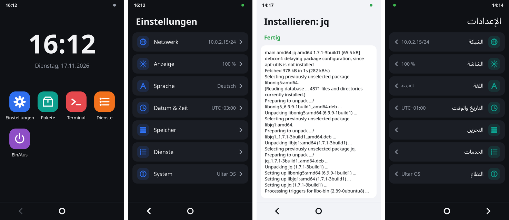
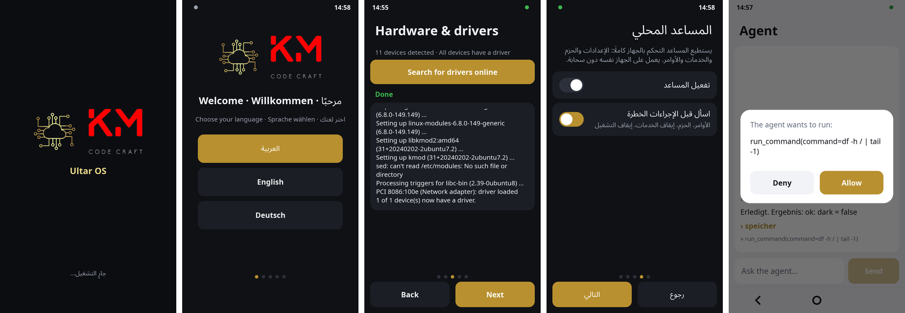
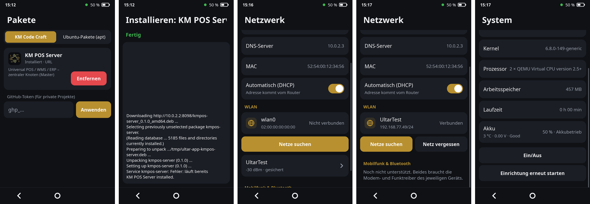
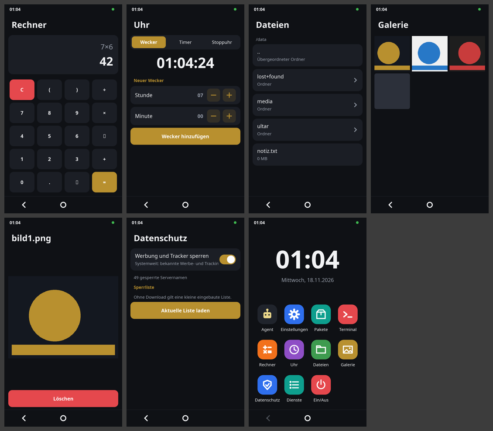
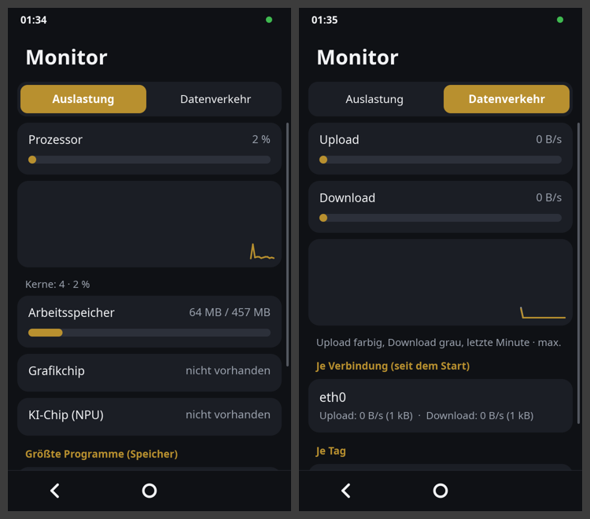
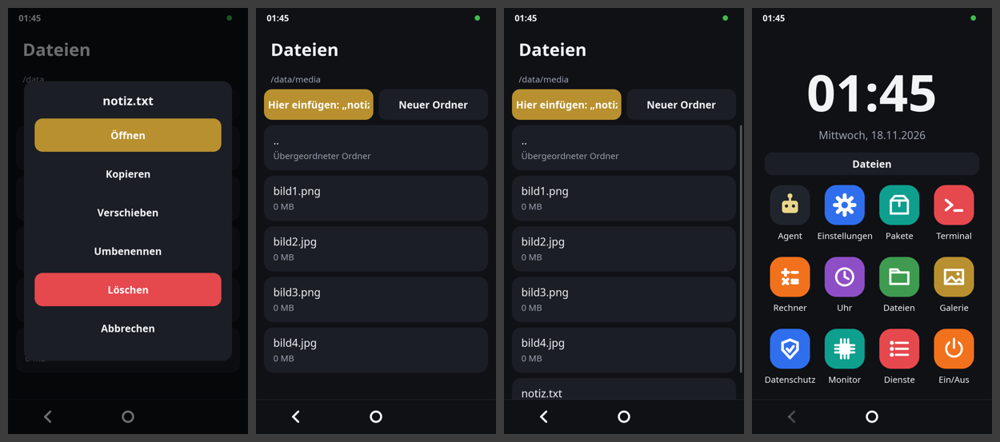
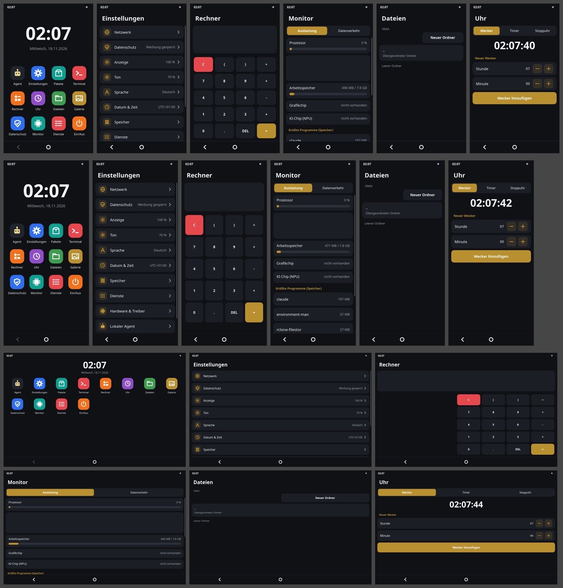
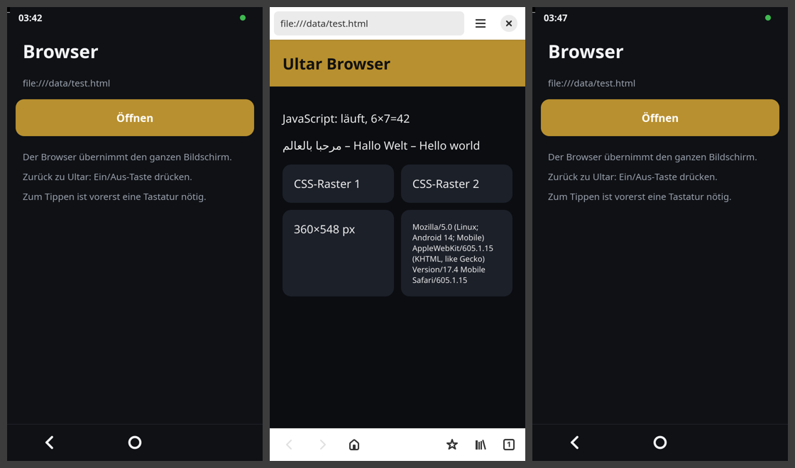
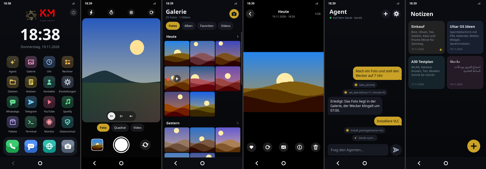
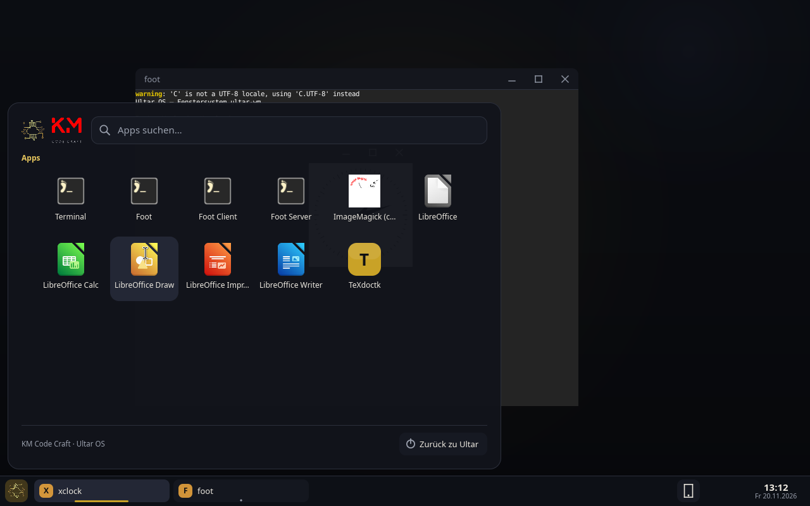

# Ultar OS – Architektur (v0.6)

KM Code Craft · Mobiles Betriebssystem als Android-Ersatz · Rust

## Ziel
Minimal, schneller als Android, volle Kontrolle (keine Hersteller-Software), kompatibel mit Ubuntu-Paketen, Updates komplett offline per USB.

## Grundentscheidung: Linux-Kernel + eigener Rust-Userspace
Android ist nicht wegen des Linux-Kernels langsam, sondern wegen des Userspace darüber
(ART/Java-VM, Zygote, system_server, Dutzende HAL-Dienste: 1–2 GB RAM und 20–40 s Bootzeit).

| Schicht | Android | Ultar OS |
|---|---|---|
| Kernel | Linux (Hersteller-Fork) | Linux LTS/Mainline, schlank konfiguriert |
| PID 1 | init + ~100 Dienste | `ultar-init` (Rust, 1,5 MB, ereignisgesteuert) |
| Laufzeit | ART/Java-VM | native Rust-Binaries, keine VM |
| Apps | APK | Rust-Dienste + Ubuntu-.deb im Compat-Bereich |
| Isolation | SELinux + UIDs | cgroup v2 pro Dienst (RAM/CPU/Prozess-Limits) + Namespaces |

**Warum kein eigener Kernel (jetzt):** Treiber für 5G-Modem, Kamera (ISP), GPU, WLAN gibt es
nur für Linux. Ein eigener Kernel hieße, alle Treiber neu zu schreiben (Jahre).
Ubuntu-Pakete brauchen außerdem die Linux-Systemaufrufe. Deshalb wächst daneben der **Ultar-Kern**
(eigener Rust-Kernel mit Linux-ABI, [KERN.md](KERN.md)): er startet per UEFI, hat eigene Treiber, liest die
ext4-Partition `ultar-compat` und führt Ubuntu-Programme (bash, coreutils, busybox) unverändert aus.

## Komponenten (implementiert)
- **ultar-init** – PID 1: mountet proc/sys/dev/run/tmp/cgroup2, Hostname, Kernel-Module,
  Zusatz-Mounts; startet Dienste in Abhängigkeitsreihenfolge (`after`, `oneshot`);
  Neustart mit exponentiellem Backoff; jeder Dienst in eigener cgroup mit Limits;
  sauberes Herunterfahren (SIGTERM → cgroup.kill → umount → poweroff/reboot).
  Ereignisschleife über signalfd + poll: 0 % CPU im Leerlauf.
- **ultar-ctl** – Steuerung: `status | start | stop | restart | uptime | poweroff | reboot`.
- **ultar-compat** – Ubuntu-Kompatibilität: Ubuntu 24.04 lebt auf eigener Partition
  (`/compat`) und läuft im privaten Mount-Namespace auf demselben Kernel – keine VM,
  kein Leistungsverlust. `apt`, `dpkg -i` (offline/USB), `run`, `shell`, `check`.
  Dienste können mit `compat = true` direkt im Ubuntu-Bereich gestartet werden.

- **ultar-net** – Netzwerkdienst: eigener DHCP-Client und statische Adressen für Kabelnetzwerk,
  setzt Adresse, Route und DNS direkt über Kernel-Schnittstellen. Status für die Oberfläche
  unter `/run/ultar/net/`. WLAN und Mobilfunk fehlen noch.
- **ultar-shell** – Oberfläche für Touch. Zeichnet direkt über DRM/KMS (kein X11, kein Wayland),
  liest Eingaben über evdev (Touchscreen, Maus, Tastatur), rendert per Software in Rust.
  Gezeichnet wird nur bei Ereignissen. Enthält Startbildschirm, Einstellungen, Paketverwaltung
  (apt im Ubuntu-Bereich), Dienste, Terminal und eine Bildschirmtastatur (Latein/Arabisch).
  Sprachen: Deutsch, Englisch, Arabisch (mit Rechts-nach-links-Layout).
  Einstellungen liegen stromausfallsicher in `/data/ultar/*.toml`.



### Einstellungen der Oberfläche
| Bereich | Inhalt |
|---|---|
| Netzwerk | Status je Schnittstelle, DHCP oder statisch (IP, Präfix, Gateway, DNS) |
| Anzeige | Helligkeit, Bildschirm-Timeout, Drehung 0/90/180/270°, Größe, hell/dunkel, Akzentfarbe |
| Sprache | Deutsch, English, العربية |
| Datum & Zeit | Zeitzone (fester UTC-Versatz), Uhrzeit und Datum stellen (auch Hardware-Uhr) |
| Speicher | RAM, System, Ubuntu-Bereich, Nutzerdaten |
| Dienste | Starten und Stoppen |
| System | Gerätename, Version, Kernel, Prozessor, Neustart/Ausschalten |

### Ersteinrichtung, Treibersuche, Agent, Marke (v0.3)


- **Marke:** Logo von KM Code Craft (Quelle: `codecraft-platform`, `apps/web/public/brand`) liegt in
  `assets/brand/` und ist in die Oberfläche eingebettet. Gold der Marke ist die Standard-Akzentfarbe.
- **Startbild:** `ultar-shell --splash <ar|en|de> <breite> <höhe> <datei.bmp>` erzeugt das Bootlogo
  mit Text in der jeweiligen Sprache als BMP (das Format, das U-Boot als Startbild lädt). Der Build legt
  sie unter `out/boot/` ab. Die Oberfläche zeigt dasselbe Bild beim Start. Die Einbindung in einen
  echten Bootloader gehört zum Board-Port (Phase 5) – in QEMU gibt es keinen.
- **Sprachen:** Arabisch ist Standardsprache und steht in der Ersteinrichtung an erster Stelle.
- **Ersteinrichtung:** Sprache → Netzwerk → Hardware & Treiber → Agent → Fertig. Später erneut
  startbar unter System.
- **Treibersuche (`hw.rs`):** findet PCI- und USB-Geräte ohne Treiber über sysfs. Die Online-Suche
  holt das zum laufenden Kernel passende Modulpaket (`linux-modules-<version>`, bei Bedarf `-extra`)
  per apt in den Ubuntu-Bereich und lädt die Treiber von dort; fehlende Firmware kommt aus
  `/compat/lib/firmware`. Gefundene Treiber stehen in `/data/ultar/drivers.list`, der Dienst `drivers`
  lädt sie bei jedem Start. **Voraussetzung:** Für den laufenden Kernel muss ein Modulpaket in den
  Paketquellen liegen. Für einen eigenen Ultar-Kernel heißt das: eigene Paketquelle von KM Code Craft.
  Geräte auf ARM-Platinen, die nur im Device-Tree stehen, erfasst die Suche noch nicht.
- **Lokaler Agent (`agent.rs`):** steuert das Gerät über Werkzeuge (Status, Einstellungen, Bildschirme,
  Dienste, Pakete, Befehle, Neustart). Das Sprachmodell läuft getrennt als Dienst `llm`
  (llama-server aus llama.cpp, Dateien unter `/data/ultar/agent/`) und wird nur lokal über die
  OpenAI-kompatible Schnittstelle angesprochen. Riskante Aktionen (Befehle, Pakete, Dienste stoppen,
  Ausschalten) brauchen standardmäßig eine Bestätigung am Bildschirm.
  **Stand:** Die Schleife ist mit einer Test-Attrappe geprüft (`scripts/agent-stub.py`), nicht mit einem
  echten Modell. Programm und Modell sind noch nicht im Image.

### WLAN, Akku, Apps, Claude (v0.4)


- **WLAN:** Netze suchen (`iw`), anmelden mit WPA2-Kennwort (`wpa_supplicant` aus dem Ubuntu-Bereich),
  Adresse per DHCP durch `ultar-net`. Zugangsdaten in `/data/ultar/wifi.conf` (nur root lesbar),
  automatische Verbindung nach Neustart. Getestet mit simuliertem Funkgerät (`mac80211_hwsim`) und
  Test-Zugangspunkt (`wifitest`), nicht mit echter WLAN-Hardware.
- **Modul-Nachladen:** `/sbin/modprobe` zeigt auf `ultar-compat`; fordert der Kernel ein Modul an
  (z. B. WLAN-Verschlüsselung), wird es aus den Modulpaketen im Ubuntu-Bereich geladen.
- **Akku:** Symbol mit Füllstand und Prozent in der Statusleiste (grün beim Laden, rot unter 15 %),
  Details unter System. Quelle: `/sys/class/power_supply`; Prozent wird notfalls aus Ladung/Energie
  berechnet. Getestet mit dem Test-Akku des Kernels (`test_power`).
- **Apps von KM Code Craft:** Katalog `/etc/ultar/apps.toml` (+ `/data/ultar/apps.toml`). Eine App ist
  ein .deb für den Ubuntu-Bereich, Quelle ist das neueste GitHub-Release (privat: mit Token) oder eine
  direkte Adresse. Dienste der App (`/usr/share/ultar/services/*.toml` im Paket) werden übernommen und
  gestartet (`ultar-ctl reload`). Erste App: **KM POS Server** aus `universal-pos-erp`
  (`scripts/package-kmpos.sh` baut das Paket). Installation über direkte Adresse getestet; der Weg über
  GitHub ist ungetestet (GitHub war aus der Testumgebung nicht erreichbar) und braucht ein Release im Projekt.
- **Claude als Agent:** Unter Lokaler Agent → Sprachmodell lässt sich statt des Modells auf dem Gerät
  Claude über die Anthropic-API wählen (API-Schlüssel nötig, Internet nötig). Gleiche Werkzeuge, gleiche
  Rückfrage bei riskanten Aktionen. Eine echte Antwort der API ist nicht getestet (kein Schlüssel; die
  Testumgebung unterbricht verschlüsselte Verbindungen).
- **Mobilfunk und Bluetooth:** nicht umgesetzt – beides hängt an Modem- und Funktreibern des konkreten Geräts.

### Zielgerät Samsung Galaxy A30 (Einschätzung)
- postmarketOS führt das A30 mit dem Samsung-Kernel 4.4 (Hersteller-Fork), nicht mit einem aktuellen Kernel.
  Für den Chip (Exynos 7904/7885) sind WLAN, Bluetooth und Modem im aktuellen Kernel als ungetestet geführt.
- Folge: Ultar OS muss auf dem A30 mit dem alten Samsung-Kernel laufen. Dafür nötig: Rückfall ohne
  cgroup v2 in `ultar-init`, Bildausgabe über fbdev (vorhanden), WLAN-Treiber des Herstellers,
  Mobilfunk über Samsungs Modem-Schnittstelle (eigenes Teilprojekt), Akku über den Samsung-Treiber.
- Voraussetzung am Gerät: entsperrter Bootloader, Flashen und Test am echten Gerät.

### Optimierung (v0.5) – gemessen in QEMU ohne KVM
| Messwert | vorher | nachher | Maßnahme |
|---|---|---|---|
| Bildzeit der Oberfläche (Mittel) | 9,3 ms | ~5 ms | Text wird einmal gerastert und danach nur als Maske eingeblendet; Oberfläche mit `opt-level 3` |
| Speicher der Oberfläche (RSS) | 14 MB | 9 MB | Ausgabe direkt in den Bildspeicher (keine Zwischenkopie), Schriften nicht mehr kopiert, kein Layout-Zwischenspeicher |
| Aufwachen im Leerlauf | 2× pro Sekunde | 1× pro Minute | Oberfläche schläft bis zum Minutenwechsel, solange nichts Laufendes angezeigt wird |
| Kernsystem-Abbild | gzip | zstd | kleiner und schneller entpackt |

Unter System → Diagnose zeigt die Oberfläche Startzeit, Bildzeit und eigenen Speicher an.
Der größte verbleibende Hebel ist der Kernel: der allgemeine Ubuntu-Kernel braucht in der Emulation rund 3,5 s
bis zum Start von `ultar-init`; ein eigener, auf das Gerät zugeschnittener Kernel fehlt noch.

### Ultar Flash (Windows-Werkzeug, `tools/ultar-flash`)
Sichert Treiber und Partitionen eines Android-Handys, flasht ein Ultar-Paket und schreibt das Original zurück.
Feste Regeln: nie Bootloader/Partitionstabelle/Modem/EFS schreiben, kein Flashen ohne geprüfte Sicherung.
Logik mit Geräte-Attrappen getestet (25 Prüfungen), nicht am echten Gerät. Details: `tools/ultar-flash/LIESMICH.md`.

### Updates aus GitHub-Releases (v0.6)
Quelle für alle Updates sind die **Releases** dieses Projekts. („Packages“ von GitHub nimmt nur Container-,
npm- und ähnliche Pakete auf, keine MSI- oder .deb-Dateien – daher laufen alle Updates über Releases.)

| Was | Datei im Release | Wer holt sie |
|---|---|---|
| Kernsystem | `ultar-initramfs-<arch>.cpio.zst` | Ultar OS: System → Systemupdate |
| Ultar Flash | `UltarFlash-<version>.msi` | Ultar Flash: prüft beim Start und über „Nach Updates suchen“ |
| Prüfsummen | `SHA256SUMS` | beide – ohne passende Prüfsumme wird nichts eingespielt |
| Apps (z. B. KM POS Server) | `*_<arch>.deb` im Release des App-Projekts | Ultar OS: Pakete → KM Code Craft → Aktualisieren |

- **Veröffentlichen:** Version in `Cargo.toml` und `tools/ultar-flash/Update.cs` erhöhen, Tag `v<version>` pushen –
  `.github/workflows/release.yml` baut alles (`scripts/make-release.sh`) und legt das Release an.
- **Privates Projekt:** Solange das Projekt privat ist, brauchen Gerät und Ultar Flash ein GitHub-Token mit Lesezugriff
  (Ultar OS: Pakete → GitHub-Token; Ultar Flash: Feld GitHub-Token).
- **Systemupdate einspielen:** Das geprüfte Abbild wird nach `boot_target` (`/etc/ultar/update.toml`) übernommen, die
  vorige Fassung bleibt als `.alt`. Ohne `boot_target` wird es nur unter `/data/ultar/update` bereitgelegt. Welche Datei
  der Bootloader lädt, legt der Board-Port fest; ein automatischer Rückfall auf `.alt` bei Startfehler fehlt noch.
- **Teststand:** Beide Updater sind gegen eine Release-Attrappe geprüft (`scripts/release-stub.py`): finden, laden,
  Prüfsumme, Ablehnung bei falscher/fehlender Prüfsumme. Gegen GitHub selbst und unter Windows nicht getestet;
  der Workflow ist noch nie gelaufen.

### Grenzen der Oberfläche (Stand v0.6)
- Installierte Ubuntu-Pakete sind Kommandozeilen- und Serverprogramme. Grafische Ubuntu-Apps
  brauchen ein Fenstersystem (Wayland-Compositor) – das ist der nächste Ausbauschritt der Oberfläche.
- Nicht vorhanden: Mobilfunk, Bluetooth, Ton, Sperrbildschirm/PIN, Zeitabgleich übers Netz,
  automatische Sommerzeit.
- Getestet in QEMU mit emuliertem Touch-Gerät; Multitouch-Pfad und echte Touchscreens noch nicht.

## Dienst-Definition (`/etc/ultar/services/<name>.toml`)
```toml
exec = "/usr/bin/km-server"
args = ["--port", "8080"]
after = ["netz"]
restart = "always"        # always | on-failure | never
compat = false            # true = im Ubuntu-Bereich ausführen
[env]
RUST_LOG = "info"
[cgroup]
"memory.max" = "512M"
"cpu.weight" = "200"
```

## Gemessen (QEMU x86_64, ohne KVM, Ubuntu-Kernel 6.8 generisch)
- Init bis „System bereit“: ~2,4 s ab Kernelstart (generischer Kernel; mit eigenem schlanken Kernel und echter Hardware deutlich weniger)
- RAM belegt nach Boot: **35 MB** ohne Oberfläche, rund **65 MB** mit Oberfläche und Netzwerkdienst (Android: >1 GB)
- Kernsystem (initramfs, inkl. Debug-Busybox, Oberfläche, Schriften und QEMU-Grafikmodulen): 5,8 MB
- Ubuntu 24.04 (bash, apt 2.7, glibc 2.39) im Compat-Bereich lauffähig, `.deb` offline installiert und ausgeführt

## Hardware-Realität (wichtig für die Geräteauswahl)
Treiber lassen sich **nicht** aus einem Android-Gerät „herauskopieren“: Android-Treiber sind
Module für genau den Hersteller-Kernel plus geschlossene Userspace-HALs.
Zwei Wege:
1. **Mainline-SoC (empfohlen für volle Kontrolle):** Chips mit guter Linux-Mainline-Unterstützung –
   Rockchip RK3566/RK3588 (Entwicklungsplatinen, Tablets), Qualcomm Snapdragon 845 / SM7225 u. a.
   (siehe postmarketOS-Gerätewiki). Kamera/Modem sind der Engpass – vor dem Hardwarekauf prüfen.
2. **Hersteller-Kernel + Hybris (schnell, beliebiges Android-Gerät):** Hersteller-Kernel und
   Android-HALs (Kamera, Modem) in einem kleinen Container behalten, Rest durch Ultar ersetzen.
   Weniger Kontrolle, aber sofort lauffähig auf günstigen MediaTek/Unisoc-Geräten.

Empfehlung: Entwicklungsplatinen auf **RK3566/RK3588** (Weg 1); beim Handy die SoC-Wahl
an der Mainline-Unterstützung von Modem + Kamera festmachen, sonst Weg 2.

## Fahrplan
| Phase | Inhalt | Status |
|---|---|---|
| 1 | ultar-init, ultar-ctl, ultar-compat, Image-Build, QEMU-Test | ✅ fertig |
| 2 | Netzwerk: Kabel mit DHCP/statisch (`ultar-net`) | ✅ fertig |
| 2b | WLAN (wpa_supplicant) | ✅ fertig (simuliert getestet) |
| 2c | Mobilfunk und Bluetooth | offen |
| 3 | Offline-Updates A/B mit Signatur (`ultar-update`, USB, Ed25519, Rollback) | offen |
| 4 | Oberfläche für Touch mit Einstellungen und Paketverwaltung (`ultar-shell`) | ✅ fertig |
| 4a | Ersteinrichtung, Treibersuche, Agent-Anbindung, Marke/Startbild | ✅ fertig |
| 4a+ | Sprachmodell für den Agenten: llama.cpp für ARM bauen, kleines Modell auswählen und testen | offen |
| 4a2 | Akkuanzeige, App-Katalog mit Installation (GitHub/Adresse), Claude als Agent-Modell | ✅ fertig |
| 4b | Fenstersystem `ultar-wm` (Rust, Wayland, Xwayland) mit Leiste, Startmenü, Desktop-/Tablet-Modus – [DESKTOP.md](DESKTOP.md); offen: Sperrbildschirm, Test auf echter GPU | ✅ Grundstock (v0.7) |
| 4c | Android-Apps als optionaler Container (Waydroid-Prinzip), Start nur auf Abruf | offen |
| 5 | Board-Port: aarch64-Kernel-Config, Device-Tree, Bootloader (U-Boot) für RK3566-Platine | offen |
| 5b | Port auf Samsung Galaxy A30 (Samsung-Kernel 4.4) | offen |
| 6 | Handy-Port: Modem, Kamera, Akku/Energieverwaltung, Gehäuse/Branding | offen |
| 7 | Optional: Rust-Kernel mit Linux-ABI | Forschung |
| 8 | Ausgaben Desktop/Laptop und Server (UEFI-Abbild, Web-Verwaltung, SSH) – `docs/AUSGABEN.md` | gebaut, Test in QEMU |
| 8a | Apps aller Formate: `.uap`, `.deb`, `.apk`, `.exe`, `.msi`, AppImage, Flatpak (`uapp`) | `.exe`/`.msi`/`.deb` getestet |

## Ausgaben (ab v0.7)
Ein Kern, drei Ausgaben: **Handy** (`phone`), **Desktop/Laptop** (`desktop`), **Server** (`server`). Dienste tragen
`editions = [...]`; `ultar-init` lädt nur die passenden. PCs starten per UEFI von einem GPT-Abbild (systemd-boot), Kernel und
Module kommen aus dem Ubuntu-Bereich. Apps aller Formate installiert `uapp`. Details: [AUSGABEN.md](AUSGABEN.md).

## Bauen & Testen
```bash
scripts/make-compat.sh                 # Ubuntu-Partition (out/compat-amd64.ext4)
scripts/build-initramfs.sh             # Kernsystem (out/ultar-initramfs-x86_64.cpio.gz)
# Kernsystem mit Grafik-/Eingabe-Modulen für QEMU (Ubuntu-Kernel hat sie nur als Module):
MODULES="virtio-gpu virtio_input" MODULES_DIR=<entpacktes linux-modules-Paket> scripts/build-initramfs.sh
KERNEL=/boot/vmlinuz-… scripts/run-qemu.sh              # Oberfläche im Fenster, Maus = Touch
KERNEL=/boot/vmlinuz-… SELFTEST=1 scripts/run-qemu.sh   # Selbsttest auf der Konsole, schaltet danach ab
KERNEL=… scripts/ui-test.py out/test "wait 14" "shot start" "tap 100 620" "shot einstellungen"   # automatischer Oberflächentest
ARCH=aarch64 scripts/build-initramfs.sh      # ARM (benötigt: rustup target add aarch64-unknown-linux-gnu)
DEBUG=0 scripts/build-initramfs.sh     # Produktions-Image ohne Shell/Testdienste
```

## Geräteschalter (ab v0.6, Zweig v0.6-gefuehrt)

Damit dasselbe Startabbild auf jedem Gerät läuft, wählt `ultar-init` jede hardwareabhängige Grundfunktion über
einen Schalter (`crates/ultar-init/src/hw.rs`):

| Funktion | Fälle (in dieser Reihenfolge) |
|---|---|
| `watchdog` | `dev_watchdog` (/dev/watchdog, watchdog0, watchdog1 bedienen) |
| `vibrator` | `timed_output`, `leds` |
| `usb` (Diagnose als serielle Schnittstelle) | `configfs` (jeder vorhandene USB-Controller), `android_usb` |
| `display` (Feststellung) | `drm`, `fbdev`, `fbdev_graphics` |
| `backlight` | erstes Gerät unter /sys/class/backlight (aus → halbe Helligkeit) |
| Bildschirm der Oberfläche (`ultar-shell`) | `drm:/dev/dri/card0…3`, `fbdev:/dev/fb0`, `/dev/graphics/fb0`, `/dev/fb1` |

- **Erster Start:** je Funktion alle Fälle der Reihe nach; der erste, der funktioniert, wird gemerkt.
- **Weitere Starts:** nur der gemerkte Fall. Versagt er, wird für diese Funktion neu gesucht und das Profil berichtigt.
- **Profil:** `/data/ultar/hw-profile.toml` (Oberfläche: `/data/ultar/display.case`), gebunden an Gerätekennung
  (Modell aus Gerätebaum/DMI + Kernel-Version). Anderes Gerät oder anderer Kernel → neu suchen.
  Abbild für andere Programme: `/run/ultar/hw.toml`. Ohne Datenpartition gilt das Profil nur für den laufenden Start.
- **Partitionen:** Mount-Quellen dürfen Kandidaten nennen, z. B. `LABEL=ultar-data|/dev/vdb`; gesucht wird der
  Dateisystem-Name über alle Blockgeräte (nur lesend).

## Start auf Handys ohne Konsole – Erkenntnisse vom Galaxy A30 (SM-A305F)

- Im Startabbild müssen `/dev/null` und `/dev/console` als Gerätedateien liegen; ohne Konsole bricht die
  Rust-Laufzeit sonst sofort ab (Kernel-Panik, Neustart-Schleife). `ultar-init` bleibt bei Programmfehlern stehen.
- Samsung nimmt eigene Abbilder nur an, wenn im Download-Modus `KG STATE: Checking` steht (nach frischem
  Android-Start erst nach einigen Minuten online). Abgelehnt wird erst beim Abschluss der Sitzung.
- vbmeta: ein **leeres, unsigniertes** vbmeta (256 Byte, Flags 2). Nur die Flags im signierten Original zu ändern
  führt zur Neustart-Schleife.
- Der Bootloader lädt beim normalen Start kein Ramdisk aus der Boot-Partition; Android schreibt die
  Recovery-Partition bei jedem Start zurück. Deshalb: eigener Kernel mit fest eingebautem Startabbild
  (`kernel/samsung-a30/LIESMICH.md`). Stand: gebaut und angenommen, Start auf dem Gerät noch nicht bestätigt.
- Fehlersuche ohne Bildschirm: Prüfstart `tools/testinit` (Vibrations-Signale), USB-Diagnose in `ultar-init`,
  „Diagnose vom Handy lesen“ in Ultar Flash.
- Ultar Flash schreibt Samsung-Geräte selbst (Odin-Protokoll über den COM-Port), auch direkt im Download-Modus
  (nur mit Schalter „Testgerät“; Gerät dann laut Sicherungsordner).

## Eingebaute Apps, Gesten und Werbesperre (Zweig v0.6-gefuehrt)


In der Oberfläche (`crates/ultar-shell/src/tools.rs`), ohne Fenstersystem:

| App | Inhalt | Stand |
|---|---|---|
| Rechner | + − × ÷ %, Klammern, Punkt vor Strich, Zwischenergebnis | getestet (Rechenkern mit Tests, Oberfläche in QEMU) |
| Uhr | Wecker (mehrere, gespeichert in `/data/ultar/alarms.toml`), Timer, Stoppuhr; Klingeln = Dialog + Vibration | Anzeige getestet; kein Ton (Audio fehlt), bei ausgeschaltetem Bildschirm bis zu 60 s verspätet |
| Dateien | Ordner durchblättern, Text und Bilder öffnen, Löschen nur unter `/data` mit zweitem Tippen | getestet in QEMU |
| Galerie | Vorschaubilder aus `/data/media`, `/data/Pictures`, `/data/DCIM`; PNG und JPEG | getestet in QEMU |
| Datenschutz | Werbe- und Tracker-Server systemweit sperren (hosts-Datei von Kernsystem und Ubuntu-Bereich); eingebaute Liste (49 Namen) oder große Liste per Download | Schreiben der Liste getestet; Download und Wirkung im Browser ungetestet |

- **Gesten:** vom linken/rechten Rand zur Mitte wischen = zurück; von der unteren Leiste nach oben = Startbildschirm.
- **Offen (brauchen Vorarbeit):** Browser und Web-Apps (WhatsApp, YouTube, Telegram) – brauchen das Fenstersystem und eine
  Web-Engine (WebKit); Telefonie und SMS – brauchen den Modem-Treiber des Geräts; Kamera – braucht den Kamera-Treiber;
  VPN (WireGuard/Proton) – braucht WireGuard im Kernel und ein Konto.

## Monitor und App-Verwaltung (Zweig v0.6-gefuehrt)


- **Monitor** (`crates/ultar-shell/src/monitor.rs`), Reiter *Auslastung*: Prozessor gesamt mit Verlauf und je Kern,
  Arbeitsspeicher, Grafikchip (Mali, Adreno, devfreq, DRM – erste lesbare Quelle), KI-Chip (NPU, bisher nur Rockchip),
  größte Programme nach Speicher. Reiter *Datenverkehr*: Upload und Download als Rate und Verlauf der letzten Minute,
  je Verbindung seit dem Start, je Tag (31 Tage, `/data/ultar/net-usage.toml`; gezählt wird auch bei geschlossenem Monitor).
  Grenzen: kein Verbrauch je App (bräuchte Zählung im Kernel je Prozess); GPU/NPU nur, wenn der Kernel die Werte anbietet.
- **Pakete → Installiert:** alles selbst Installierte (KM-Apps und Ubuntu-Pakete) in einer Liste, Entfernen mit einem Tippen
  (Ubuntu-Pakete samt nicht mehr gebrauchter Abhängigkeiten). Installieren bleibt ein Tippen im Katalog bzw. in der Suche.

## Dateiarbeiten, Kontextmenü, gelernter Schnellzugriff (Zweig v0.6-gefuehrt)


- **Langer Druck** (0,55 s) auf einen Eintrag in *Dateien* öffnet ein Menü: Öffnen, Kopieren, Verschieben, Umbenennen, Löschen.
  Kopieren/Verschieben: Eintrag merken, Zielordner öffnen, „Hier einfügen“. Ordner werden samt Inhalt kopiert, gleiche Namen
  bekommen „(2)“. „Neuer Ordner“ in der Werkzeugleiste. Schreiben ist nur unter `/data` erlaubt.
- **Gelernter Schnellzugriff:** die bis zu vier meistgenutzten Apps (ab drei Starts) stehen über dem Raster des
  Startbildschirms (`/data/ultar/launches.toml`). Das ist bisher das einzige lernende Verhalten.
- Getestet in QEMU (Menü, Kopieren mit Einfügen, Schnellzugriff) und mit Tests für die Dateiarbeiten.
- **Offen:** Ton (Wecker, Benachrichtigungen), Mobilfunk mit Netz- und Zellenwahl, Kontextmenüs außerhalb von *Dateien*.

## Ton und Anpassung an jede Bildschirmgröße (Zweig v0.6-gefuehrt)


- **Ton** (`crates/ultar-shell/src/audio.rs`): Ausgabe direkt über die ALSA-Schnittstelle des Kernels (48 kHz, 16 Bit, Stereo),
  ohne Zusatzprogramme; der Mischer wird beim Abspielen eingeschaltet. Weckton, Hinweiston, Einstellungen → Ton
  (ein/aus, Lautstärke, Testton). Prüfung: `ultar-shell --beep` bzw. Dienst `tontest`; in QEMU (AC97) aufgezeichnet und
  ausgewertet – 880/1175/1568 Hz, 1,25 s. Auf echter Hardware ungetestet; Handys brauchen meist zusätzlich das Einschalten
  des Lautsprecherwegs im Mischer (gerätespezifisch).
- **Maßstab** (`ui::scale_for`): Handy = kurze Seite 360 dp, mindestens 640 dp Länge; Tablet/Monitor (kurze Seite ab 700 px
  und Seitenverhältnis unter 1,7) = kurze Seite 600 dp. Startbildschirm: Spaltenzahl nach Breite, Zeilenhöhe und Symbolgröße
  nach Höhe; Rechner füllt die Höhe. Geprüft mit `ultar-shell --shot <b> <h> <bildschirm> <sprache> <datei.bmp>` für
  480×800, 720×1280, 1080×2340 und 1280×800.
- **Offen aus der Gestaltungsprüfung:** Listen laufen auf Tablets über die volle Breite (noch keine zweispaltige Ansicht);
  Rechenzeichen im Rechner nicht hervorgehoben; „Ton“ und „Anzeige“ teilen sich ein Symbol; helles Design und Arabisch
  nur stichprobenweise angesehen.

## Fenstersystem und Browser (Zweig v0.6-gefuehrt, auf main)


- **Aufbau:** Der Browser läuft im Ubuntu-Bereich: Weston (Wayland-Fenstersystem, ohne Leiste, Software-Darstellung) und
  GNOME Web/Epiphany (WebKit-Engine) im maximierten Fenster. Start über `rootfs/usr/lib/ultar/web-session.sh`.
- **Übergabe des Bildschirms:** `ultar-shell` gibt Bildschirm und Eingabe ab, wartet auf das Ende der Sitzung und übernimmt
  wieder. Rückweg unabhängig vom Browser: Ein/Aus-Taste (auch Home, F12) beendet die Sitzung.
- **Maßstab:** ganzzahliger Ausgabemaßstab aus dem Geräte-Maßstab (Handy 720×1280 → 2, Webseiten sehen 360 Punkte Breite);
  Epiphany zeigt dann von selbst seine Handy-Anordnung (Adresszeile oben, Navigation unten).
- **Schutz:** Werbefilter und Tracking-Schutz von Epiphany an, dazu die systemweite Sperrliste; Suchmaschine DuckDuckGo;
  mobile Kennung für Webseiten, für WhatsApp Web und Telegram Web die Fassung für große Bildschirme.
- **Web-Apps:** Symbole Browser, WhatsApp, YouTube, Telegram auf dem Startbildschirm; öffnen die jeweilige Adresse.
  Fehlt der Browser, bietet die Oberfläche die Installation an (apt, rund 1 GB im Ubuntu-Bereich).
- **Getestet in QEMU:** Start aus der Oberfläche, Darstellung einer lokalen Testseite (HTML, CSS-Raster, JavaScript,
  arabischer Text), Maus-Eingabe, Rückkehr per Taste. udev muss im Ubuntu-Bereich mit `SYSTEMD_IGNORE_CHROOT=1` laufen,
  sonst findet das Fenstersystem keine Eingabegeräte.
- **Nicht getestet / offen:** echte Webseiten (die Testumgebung hat aus der virtuellen Maschine kein Internet), also auch
  WhatsApp, YouTube und Telegram; Touch-Eingabe am echten Gerät; ARM-Gerät. **Bildschirmtastatur im Browser fehlt** –
  Tippen geht nur mit angeschlossener Tastatur. Die WebKit-Abschottung (bubblewrap) ist abgeschaltet, weil der Browser
  als root im Ubuntu-Bereich läuft. Darstellung in Software: auf schwachen Geräten langsam; Video ungetestet.

## Apps neu entwickelt (19.11.2026)


Kamera (Foto/Quadrat/Video, Selbstauslöser, Zoom, Raster), Galerie (Datum, Alben, Favoriten, Videos, Vollbild-Betrachter,
Hintergrundbild), Agent (Sprechblasen, Werkzeuge für alle Apps, Einrichtung des lokalen Sprachmodells mit llama.cpp im
Ubuntu-Bereich), Notizen, Kontakte, Ubuntu-Programme, Startbildschirm mit Dock. Einzelheiten, Teststand und Offenes:
[`APPS.md`](APPS.md). Arabisch: `bilder/apps-neu-ar.png`.

## Ultar-Desktop: Fenstersystem `ultar-wm` (v0.7)


Eigener Wayland-Compositor in Rust (`crates/ultar-wm`, Basis Smithay/Anvil, MIT) mit Leiste, Startmenü (alle installierten
Programme, Suche), Ultar-Fensterköpfen, Minimieren/Maximieren/Andocken, Alt+Tab, Desktop-/Tablet-Modus und Arabisch.
GPU über DRM/KMS + OpenGL ES, X11-Programme über Xwayland. Läuft im Ubuntu-Bereich, Start aus der Oberfläche
(Pakete → Ubuntu-Programme → „Desktop starten“). Details, Tasten und Teststand: [DESKTOP.md](DESKTOP.md).


## Ultar-Verbund (22.11.2026)

Ultar-Geräte schließen sich auf Wunsch zu einem Verbund zusammen (Einzelheiten: [VERBUND.md](VERBUND.md)).
Entscheidungen:
- **Noise_XX (X25519/ChaCha20-Poly1305/BLAKE2s)** statt TLS: kein Zertifikatswesen, gegenseitige Authentisierung
  über statische Geräteschlüssel, derselbe Kanal direkt und über das Relais – der Server sieht nur Chiffretext.
- **Vertrauen** nur über das eigene Konto oder einen 6-stelligen Code mit HMAC-Beweis; nie über die bloße Meldung.
- **Idempotente Aufgaben + Lebenszeichen + Umplanung** statt verteiltem Konsens: jede Aufgabe genau ein Ergebnis,
  Ausfälle (Absturz, Netztrennung, Relais weg, kaputte Rahmen) werden durch Wiederholung aufgefangen.
- **Schalter auf Kernebene:** der Ultar-Kern sperrt bei AUS die Verbund-Ports selbst; der Dienst folgt dem Schalter.
- Prüfung durch **Chaos-Engineering** (`tools/verbund-chaos/`), auch mit dem Ultar-Kern in QEMU.

## Zellen & Container (22.11.2026)

Abschottung je App/Container (Einzelheiten: [ZELLEN.md](ZELLEN.md)). Entscheidungen:
- **Linux-Namensräume statt VM**: Netz, Mount, PID, UTS, IPC je Zelle; eigene UID, `no_new_privs`, cgroup v2 für RAM.
- **Killswitch über Schnittstellen statt Adressen**: Weiterleitung nur zur VPN-Zelle, `unreachable`-Rückfallroute –
  fällt der Tunnel weg, gibt es keinen Umweg über das normale Netz.
- **Wächter als transparenter Proxy** in der Zelle (nftables `redirect` nach UID): sieht Ziel, SNI/Host, Bytes und
  unverschlüsselte Uploads, ohne TLS aufzubrechen.
- **Kiri nur über offizielle Pakete + Docker-API** angebunden (kein eigener Fork), Empfehlung gegen Doppelinstallationen.
- **Grafikkarten**: Summieren nur für Rechenarbeit (Umgebungsvariablen für CUDA/ROCm/llama.cpp), Zeichnen je Karte.
