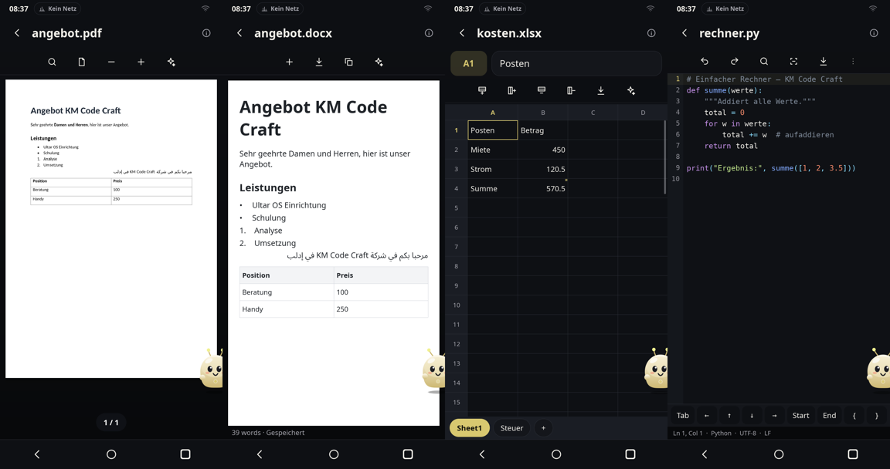
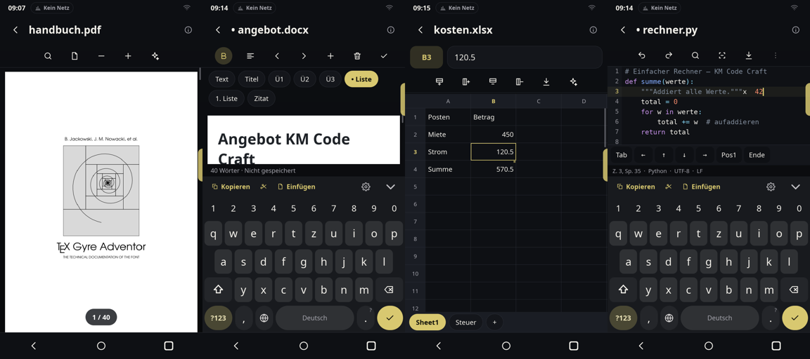

# Ultar OS – Büro-Apps (PDF, Dokumente, Tabellen, Code-Editor)

KM Code Craft · Crate `crates/ultar-office` (Kern) + `crates/ultar-shell/src/app_office.rs` (Oberfläche)



Vier eigene Apps, **ohne Ubuntu-Bereich, ohne LibreOffice, ohne Linux- oder Windows-Programme**: alles ist reines Rust,
statisch gebaut, ohne C-Bibliotheken. Dieselben Programme laufen auf dem Handy (Linux-Kern des Geräts) und auf dem
eigenen **Ultar-Kern** (Linux-ABI) – dort geprüft, siehe unten.

| App (Startbildschirm) | Dateien | Kann |
|---|---|---|
| **PDF-Leser** | `.pdf` | Seiten rendern (Vektoren, eingebettete Schriften, Bilder), Zoom 100–400 % mit Verschieben, Doppeltippen = 2×, Seitenanzeige, Suche über alle Seiten mit Sprung, Lesemodus (Text der Seite, kopierbar), arabischer Text richtig herum |
| **Dokumente** (Word) | `.docx`, `.md`, `.txt` | Öffnen und schreiben; Absatz antippen = bearbeiten, Enter teilt, Rücktaste am Anfang verbindet; Titel, Ü1–Ü3, Aufzählung, Nummerierung, Zitat; fett, Ausrichtung; Tabellen anzeigen; Arabisch rechts-nach-links (auch in der Datei: `w:bidi`) |
| **Tabellen** (Excel) | `.xlsx`, `.csv`, `.tsv` | Raster mit festen Kopfzeilen, mehrere Blätter, Eingabezeile mit Formel-Tasten; Zelle antippen während einer Formel fügt ihren Bezug ein; Zeilen/Spalten einfügen/löschen; berechnete Werte werden mitgespeichert |
| **Code-Editor** (Notepad++) | jede Text-/Code-Datei | Zeilennummern, Hervorhebung für 21 Sprachen, Schreibmarke überall, Auswahl, Rückgängig/Wiederholen, Suchen/Ersetzen (Groß/klein, ganzes Wort, reguläre Ausdrücke), Gehe zu Zeile, Zeile verdoppeln/löschen/verschieben, Kommentar umschalten, Ein-/Ausrücken, automatische Klammern und Einrückung, mehrere Dateien als Reiter, Kodierung (UTF-8 ±BOM, UTF-16, Windows-1256 arabisch, Windows-1252) und Zeilenende (LF/CRLF) bleiben erhalten oder werden umgestellt, Schriftgröße |

- **Speichern:** beim Verlassen automatisch (wie Notizen), zusätzlich Speichern-Knopf. Schreiben geschieht
  stromausfallsicher (erst Nachbardatei, dann umbenennen).
- **Öffnen:** aus der App-Liste (neueste Dateien des Nutzerbereichs, ohne `/data/ultar`) oder aus der Dateien-App –
  PDF/Word/Excel/Text öffnen dort direkt die passende Büro-App.
- **Formeln:** `SUM AVERAGE MIN MAX COUNT COUNTA COUNTBLANK PRODUCT MEDIAN STDEV VAR IF IFERROR AND OR NOT ROUND
  ROUNDUP ROUNDDOWN INT ABS SQRT POWER MOD PI LEN UPPER LOWER TRIM LEFT RIGHT MID CONCAT TEXTJOIN SUMIF COUNTIF AVERAGEIF
  VLOOKUP HLOOKUP INDEX MATCH ISNUMBER ISBLANK ISTEXT VALUE TEXT`, Operatoren `+ - * / ^ & % = <> < > <= >=`, Bezüge
  `A1`, `$A$1`, `A1:C9`, `Blatt2!B3`; Zirkelbezug → `#CIRC!`. `;` wird wie `,` behandelt.

## KI-Agent

Der lokale Agent (und Claude, wenn eingestellt) arbeitet mit denselben Funktionen – als Werkzeuge in der Oberfläche:

| Werkzeug | Zweck |
|---|---|
| `list_docs {"kind"}` | neueste Dokumente (pdf, doc, sheet, code, all) |
| `doc_current {}` | was gerade offen ist: Datei, Seite, gewählter Absatz, Zelle, Zeile/Auswahl im Code |
| `open_doc {"path"}` | Datei in der passenden App öffnen |
| `doc_info`, `doc_read {"path","page"}` | Eckdaten; Inhalt als Text (PDF-Text, .docx als Markdown, Tabellen mit `[Formeln]`) |
| `doc_create {"path","content"}` | neue Datei: .docx aus Markdown, .xlsx/.csv aus CSV, sonst Text (Überschreiben fragt nach) |
| `doc_append`, `doc_replace` | anhängen, suchen/ersetzen (auch regulär) in Dokument, Tabelle, Code |
| `sheet_read`, `sheet_set`, `sheet_eval` | Bereiche lesen, Zellen/Formeln setzen, rechnen |
| `pdf_search` | Seiten mit einem Suchwort |

Grenzen wie bisher: nur Dateien unter `/data`, nie `/data/ultar`. In jeder App öffnet der Funken-Knopf das Gespräch mit
vorbereiteter Frage zur offenen Datei. Ändert der Agent eine offene Datei, lädt die App sie neu.

Außerhalb der Oberfläche (Skripte, Server, Ultar-Kern): **`udoc`** (Teil des Abbilds, `/usr/bin/udoc`):

```
udoc info|text <datei>            udoc pdf-text|pdf-search|pdf-render …
udoc create <datei> <inhalt|->    udoc replace <datei> <suche> <ersatz> [--regex]
udoc sheet-get <xlsx> [A1:C5]     udoc sheet-set <xlsx> <Blatt!B3> <wert|=formel>
udoc eval <formel>                udoc convert <ein> <aus>   udoc lines|insert …     (--json für JSON)
```

## Geprüft

| Was | Wie | Ergebnis |
|---|---|---|
| Formeln, CSV, Markdown, .docx/.xlsx hin und zurück, Kodierungen, Editor, Hervorhebung | `cargo test -p ultar-office` | 16/16 |
| Ablauf in der Oberfläche: Absatz bearbeiten/teilen + Speichern als .docx, Formel in Tabelle + Enter, Code tippen mit Klammern, Suchen, Agent `doc_current`, Sperre außerhalb `/data` | `cargo test -p ultar-shell buero_apps` | ok |
| Von uns geschriebene .docx/.xlsx in LibreOffice | `soffice --convert-to pdf/csv` | öffnet, Formeln berechnet (570.5), Arabisch rechts |
| Diese PDF (LibreOffice-Ausgabe) mit eigenem Leser | `udoc pdf-text` / `pdf-render` | Text inkl. Arabisch richtig; Seite 1080 px in ~50 ms |
| **Auf dem Ultar-Kern** (QEMU, OVMF, eigener Kernel ohne Linux) – Befehlszeile | `tools/kern-test/qtest.py` mit statischem `udoc` | PDF lesen/rendern, .docx lesen/erzeugen, .xlsx Formel setzen/lesen, Code ersetzen – alles ok |
| **Auf dem Ultar-Kern – Oberfläche** (`ultar-shell` statisch über `/dev/fb0`, Maus/Tastatur des Kerns) | `MIT_SHELL=1 ROOT_MB=200 BUERO_DATEIEN="…" tools/kern-test/make-test-disk.sh`, dann `tools/kern-test/qui.py` mit `ultar-shell --open office:/root/buero/<datei> de` | PDF (40 Seiten) gerendert, Dokument: Absatz antippen + tippen + Enter, Code: Schreibmarke per Klick + tippen, Tabelle: Zelle wählen – siehe Bild |
| aarch64 (Handy) | statisch gebaut (`-Z build-std`), unter `qemu-aarch64` ausgeführt | ok (5,4 MB) |
| Bildschirme | `ultar-shell --shot 720 1520 …` de/en/ar | `pdf`, `docs`, `sheets`, `code`, `office:<pfad>`, `officeedit:<pfad>` (Bearbeitungszustand) |



Neu dafür: `ultar-shell --open <bildschirm> [sprache]` (Startbildschirm vorgeben, z. B. `office:/data/Documents/a.pdf`),
Prüfansicht `officeedit:<pfad>` für Bildschirmfotos.

Auf dem A30 selbst noch nicht gelaufen (Gerät nicht verbunden).

## Grenzen (ehrlich)

- PDF: verschlüsselte PDFs nur mit Kennwort-API (Oberfläche fragt noch nicht), kein Ausfüllen von Formularen,
  keine Anmerkungen; eingescannte Seiten haben keinen Text (keine Texterkennung).
- Dokumente: gemischte Formatierung innerhalb eines Absatzes bleibt in der Datei erhalten, wird aber einheitlich
  angezeigt; beim Bearbeiten eines Absatzes übernimmt er das Format seines Anfangs. Bilder, Kopf-/Fußzeilen,
  Fußnoten und Änderungsverfolgung werden nicht angezeigt (Bilder gehen beim Speichern verloren). Tabellen nur
  ansehen. Kein Export nach PDF (noch).
- Tabellen: keine Zellformate (Datum, Währung, Farben), keine Diagramme; Datumswerte erscheinen als Zahl.
- `.doc`/`.xls`/`.pptx`/`.odt` (alte bzw. andere Formate) werden nicht geöffnet.
