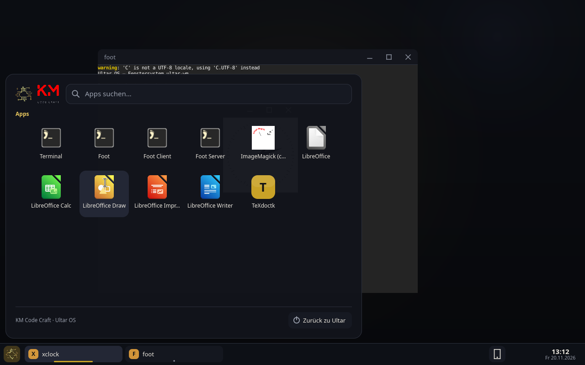
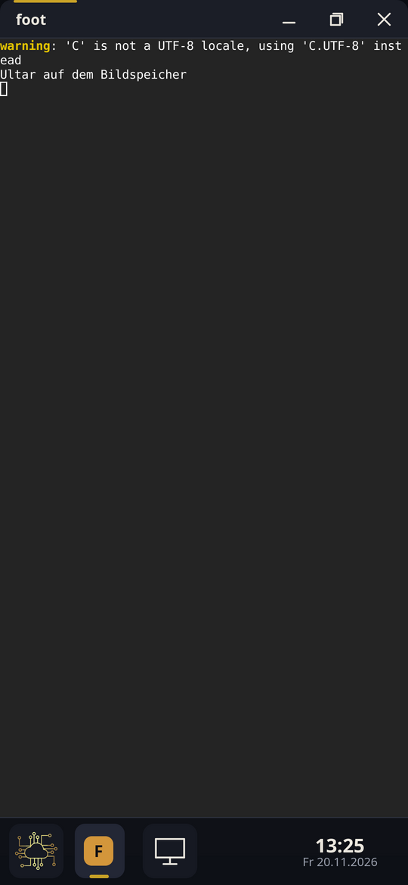

# Ultar-Desktop – Fenstersystem `ultar-wm` (v0.7)

KM Code Craft · eigenes Fenstersystem in Rust (Wayland-Compositor) für Ultar OS auf PC, Tablet und Platinen.
Grundlage für den Desktop-Modus, grafische Ubuntu-Programme (VS Code, Firefox, LibreOffice …) und später die
Windows-Schicht (Wine/Proton).

## Aufbau

| Teil | Datei | Inhalt |
|---|---|---|
| Kern (Wayland-Protokolle, Fenster, Eingabe, Ausgabe) | `crates/ultar-wm/src/{state,shell,input_handler,udev,winit,x11}.rs` | Basis: Smithay/Anvil 0.7 (MIT, siehe `LICENSE-SMITHAY-MIT.txt`) |
| Ultar-Desktop | `crates/ultar-wm/src/ultar/` | Leiste, Startmenü, Hintergrund, Fensterverwaltung, Desktop-/Tablet-Modus |
| Fensterköpfe | `crates/ultar-wm/src/shell/ssd.rs` | Ultar-Stil: Titel, Minimieren, Maximieren, Schließen, Doppelklick = maximieren |
| Sitzung | `rootfs/usr/lib/ultar/desktop-session.sh` | startet `ultar-wm --drm` im Ubuntu-Bereich (udev, libseat ohne logind, dbus) |
| Paket | `scripts/package-ultar-wm.sh` | baut `ultar-wm_<ver>_<arch>.deb` für den Ubuntu-Bereich |
| Vorgaben | `rootfs/etc/ultar/desktop.toml` | Modus, Sprache, Terminal, Autostart, eigene Startmenü-Einträge |

| Bildspeicher-Weg (ohne DRM) | `crates/ultar-wm/src/fb.rs`, `src/decon.rs` | fbdev oder Samsung DECON (A30), Pixman, libinput im Pfad-Modus |
| Bau für PC und ARM | `.github/workflows/ultar-wm.yml` | .deb für amd64 und arm64 (Multiarch-Querübersetzung) |

Eigenes Cargo-Workspace (`crates/ultar-wm`, im Haupt-Workspace ausgeschlossen): ultar-wm läuft im Ubuntu-Bereich und
nutzt dort Mesa (GPU), libinput, libseat und Xwayland – der statische Geräte-Build der übrigen Crates bleibt unberührt.

**Zwei Anzeigewege, automatisch gewählt** (`ultar-wm` ohne Angabe, ebenso `desktop-session.sh`):

| Weg | Wann | Darstellung | Eingabe |
|---|---|---|---|
| `--drm` | `/dev/dri/card*` vorhanden (PC, Tablets, RK3588) | GPU über DRM/KMS + OpenGL ES | libinput über udev, libseat |
| `--fb` | kein DRM-Treiber (Galaxy A30, einfache Platinen) | Pixman auf der CPU, nur geänderte Bereiche, Ausgabe über fbdev oder DECON (ION + `S3CFB_WIN_CONFIG`, wie ultar-shell) | libinput im Pfad-Modus (direkt `/dev/input/event*`; udevd im Ubuntu-Bereich muss die Geräte erfasst haben) |

Beim Bildspeicher-Weg: Bildschirm aus `ULTAR_WM_FB` (`decon:/dev/fb0`, `fbdev:/dev/fb0`, `file:/pfad/BxH` zum Prüfen),
sonst wie in der Oberfläche gemerkt (`/data/ultar/display.case`), sonst DECON (mit `/dev/ion`), dann fbdev.
Maßstab `ULTAR_WM_SCALE` oder automatisch (Handy: kurze Seite ≈ 400 Punkte → A30 Maßstab 3, Tablet-Modus),
Drehung `ULTAR_WM_ROTATE=90|180|270`. Programme rechnen dort in Software (`LIBGL_ALWAYS_SOFTWARE=1`).

**Darstellung (DRM-Weg):** Fensterinhalte über die GPU (OpenGL ES, bei mehreren Grafikchips MultiRenderer, Direct Scanout auf
Hardware-Ebenen). Leiste, Startmenü, Hintergrund und Fensterköpfe zeichnet Ultar auf der CPU nur bei Änderungen
(Zwischenspeicher je Bildschirm, Schlüssel aus Inhalt) und übergibt sie als Speicherpuffer – kein Neuzeichnen pro Bild.

## Funktionen

- **Leiste unten:** Start (KM-Zeichen), Fensterliste (aktiv = goldener Strich, minimiert = gedimmt; Klick holt nach vorn,
  Klick auf das aktive Fenster minimiert), Modus-Schalter Desktop/Tablet, Akku (wenn vorhanden), Uhr mit Wochentag.
- **Startmenü:** alle Programme mit `.desktop`-Datei (`/usr/share/applications`, `~/.local/share/applications`, Flatpak)
  mit PNG-Symbolen, eigene Einträge aus `desktop.toml` vorn; Suche per Tastatur (Name, Stichwörter), Enter startet den
  ersten Treffer, Mausrad blättert; „Zurück zu Ultar“ beendet die Sitzung.
- **Fenster:** Ultar-Fensterköpfe für alle Apps, die es zulassen (xdg-decoration, Standard: Server-Seite); Verschieben,
  Größe ändern, Maximieren ohne die Leiste zu verdecken, Minimieren, Andocken links/rechts.
- **Tablet-Modus:** jedes Fenster füllt den Bildschirm, größere Leiste. `mode = "auto"` wählt ihn bei Bildschirmen
  unter 900 Punkten Breite.
- **Arabisch:** komplette Spiegelung (Leiste, Startmenü), Shaping über cosmic-text mit den Noto-Schriften der Oberfläche.
  Sprache wie die Ultar-Oberfläche (`/data/ultar/settings.toml`) oder `lang` in `desktop.toml`.
- **Programme:** Wayland-Apps nativ; X11-Apps über Xwayland. Gestartete Programme bekommen
  `ELECTRON_OZONE_PLATFORM_HINT=auto` (VS Code, Discord nativ unter Wayland), `QT_QPA_PLATFORM=wayland;xcb`,
  `GDK_BACKEND=wayland,x11`, `MOZ_ENABLE_WAYLAND=1`.
- **Protokolle (aus Smithay):** xdg-shell, xdg-decoration, layer-shell, Zwischenablage (auch primary/data-control),
  Viewporter, Fractional Scale, dmabuf, Präsentationszeit, Zeigersperre, Tablett/Stift, Gesten, Bildschirm-Lease.

### Tasten

| Taste | Wirkung |
|---|---|
| Super+Leertaste, Super+A, Alt+F1 | Startmenü |
| Alt+Tab | nächstes Fenster (auch minimierte) |
| Super+← / → | links / rechts andocken |
| Super+↑ | maximieren / wiederherstellen |
| Super+↓ | minimieren |
| Alt+F4, Super+Q | Fenster schließen |
| Super+Enter, Strg+Alt+T | Terminal |
| Strg+Alt+Rücktaste | Sitzung beenden (zurück zur Ultar-Oberfläche) |

## Start

- **Aus der Ultar-Oberfläche:** Pakete → Ubuntu-Programme → „Desktop starten“ (nur sichtbar, wenn `ultar-wm` installiert
  ist; braucht `/dev/dri/card*`). Die Oberfläche gibt den Bildschirm ab und übernimmt ihn nach dem Ende wieder;
  Rückweg unabhängig vom Desktop: Ein/Aus-Taste (im Desktop nur diese, Pos1/F12 bleiben für die Arbeit frei).
- **Installation im Ubuntu-Bereich:** `scripts/package-ultar-wm.sh` → `ultar-compat apt install ./ultar-wm_0.7.0_amd64.deb`.
- **Entwicklung:** `cargo run -- --winit` in einer bestehenden Sitzung (X11 oder Wayland) öffnet den Desktop als Fenster;
  `ULTAR_WM_CONFIG=/pfad/desktop.toml` für eigene Vorgaben.

## Getestet

| Was | Wie | Ergebnis |
|---|---|---|
| Build Debug/Release, .deb | Ubuntu 24.04 x86_64 | ok (Binärdatei 17 MB, Paket 4,8 MB) |
| Leiste, Uhr, Fensterliste, Minimieren, Fokus | winit-Backend unter Xvfb (Mesa llvmpipe), xdotool | ok |
| Startmenü: Öffnen, Suche, Enter startet, Klick startet, Hover | wie oben, 11 installierte Programme mit Symbolen | ok |
| Andocken (Super+←), Tablet-Modus (alle Fenster maximiert) | wie oben | ok |
| Wayland-App (foot) und X11-App über Xwayland (xclock) mit Ultar-Fensterköpfen | wie oben | ok |
| Arabisch (Spiegelung, Shaping) | `lang = "ar"` | ok |
| Unit-Test `.desktop`-Leser | `cargo test` | ok |
| Bildspeicher-Weg (Pixman, Ausgabe in Datei 1080×2340, Maßstab 3, Tablet-Modus automatisch, foot) | `ULTAR_WM_FB=file:…` | ok |
| Galaxy A30: Ubuntu-Bereich aus ubuntu-base 24.04 in `/data/compat` (Dienst `compat-bind` legt es auf `/compat`), `ultar-wm` per apt installiert, Start über `desktop-session.sh` | am Gerät per Tür | läuft: DECON 1080×2340, Maßstab 3, 5 Eingabegeräte über libinput, Xwayland, foot verbunden |
| .deb amd64 und arm64 | GitHub Actions `ultar-wm` (arm64 quer übersetzt) | ok, Artefakte `ultar-wm-amd64`, `ultar-wm-arm64` |

**Nicht getestet:** DECON-Ausgabe und Touch am A30 (Anzeige-Code ist derselbe, der in ultar-shell am Gerät läuft),
Lauf des arm64-Pakets auf dem Gerät, DRM/KMS-Backend auf echter Hardware (die Testumgebung hat keinen Grafikchip – der Code ist der
erprobte Anvil-Weg, nur um Leiste/Arbeitsfläche ergänzt), Touch auf echtem Gerät, VS Code/Firefox (nicht installiert
in der Testumgebung), mehrere Bildschirme.

## Grenzen und nächste Schritte

- **A30:** läuft über den Bildspeicher-Weg (`--fb`). Ubuntu-Bereich liegt in `/data/compat` (aus ubuntu-base 24.04,
  Pakete über apt direkt am Gerät), der Dienst `compat-bind` legt ihn beim Start auf `/compat`. Ohne GPU-Treiber zeichnen Programme in Software –
  für Terminal, Dateien, Office-Programme ausreichend, Browser und Video spürbar langsamer.
- Symbole nur als PNG (SVG-Symbole bekommen eine Buchstaben-Kachel).
- Sperrbildschirm, Benachrichtigungen im Desktop, Bildschirmtastatur für Touch, Einstellungen-App, Arbeitsflächen.
- Danach: Windows-Schicht (`ultar-bridge`, Wine/Proton/DXVK, abgeschottet je App) auf diesem Fenstersystem.
