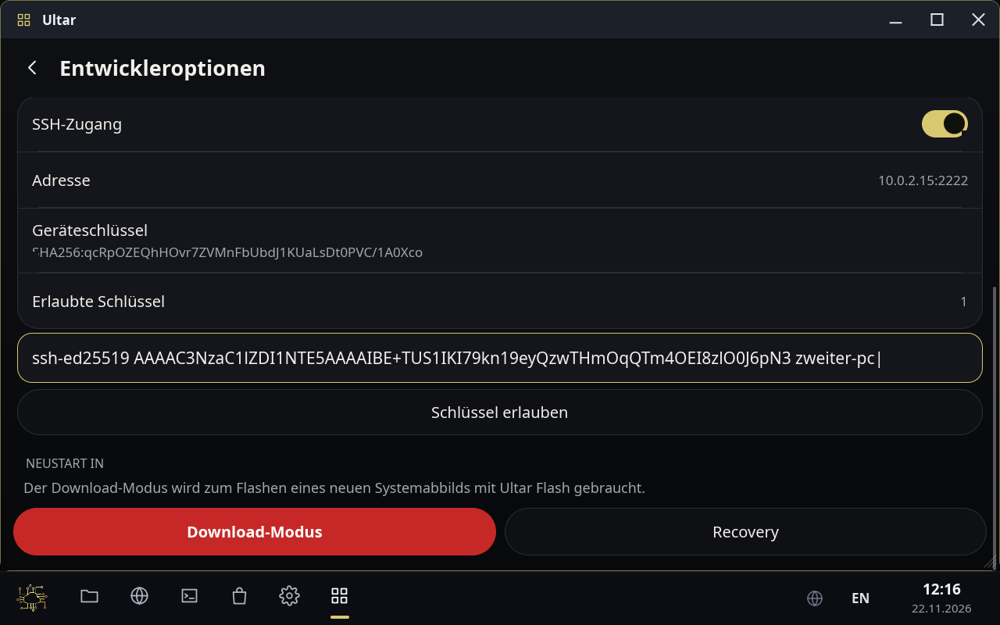

# Entwickler-Zugang (SSH) – PC steuert das Gerät

Während der Entwicklung steuert der PC – und Claude auf dem PC – ein Ultar-Gerät über SSH: Befehle ausführen,
Kernprotokoll und Dienst-Protokolle lesen, Dateien kopieren, Bildschirmfotos holen, tippen, wischen, Text eingeben,
Seiten öffnen und Gerätedienste (z. B. das Sprachmodell) auf den PC weiterleiten.

Der Dienst heißt `ultar-sshd`. Er ist in reinem Rust geschrieben (russh), statisch gebaut und läuft gleich:

- auf dem **Ultar-Kern** (eigener Kern): Der Kern startet ihn als Hintergrund-Dienst neben Konsole und Oberfläche;
- auf dem **Handy und dem PC unter Linux** als Dienst `entwickler` von ultar-init.

Er braucht keinen Ubuntu-Bereich.



## Sicherheit

| Regel | Umsetzung |
|---|---|
| Nur Schlüssel | Kennwort-Anmeldung gibt es nicht; angeboten wird nur `publickey`. |
| Aus, bis eingeschaltet | Eingeschaltet über `/data/ultar/entwickler/an` (Einstellungen oder `ultar-sshd an`), über `/etc/ultar/entwickler` (Entwicklungs-Abbild) oder über den Startparameter `ultar.entwickler=1`. Ist `…/aus` gesetzt, ist er immer aus, auch gegen das Abbild. |
| Ohne erlaubten Schlüssel kein Port | Ohne erlaubten Schlüssel beendet sich der Dienst sofort. |
| Brandmauer (Ultar-Kern) | Nur der eine Port (Standard 2222) wird geöffnet, alles andere bleibt zu. |
| Weiterleitung nur auf das Gerät selbst | Nur `127.0.0.1`/`localhost`/`::1` sind erlaubt; das Gerät dient nicht als Sprungbrett ins Netz. |
| Gleicher Geräteschlüssel nach Neustart | Der Wirtsschlüssel liegt in `/data/ultar/entwickler/host_ed25519` (im Abbild: `/etc/ultar/entwickler.host`). Der PC meldet deshalb keinen „geänderten Schlüssel“. |
| Protokoll | Jede Anmeldung, jeder Befehl, jede SFTP-Sitzung und jede Weiterleitung erscheint im Protokoll: Kernprotokoll bzw. `ultar-ctl log entwickler`. |

**Erlaubte Schlüssel** stehen in `/data/ultar/entwickler/authorized_keys` (zur Laufzeit) und in `/etc/ultar/entwickler.keys` (zur Bauzeit).

## Einrichten

### 1. PC: Schlüssel und SSH-Eintrag

Windows (PowerShell, eingebautes OpenSSH):

```powershell
tools\entwickler\ultar-dev.ps1 einrichten -Adresse 192.168.1.50            # Eintrag "ultar"
tools\entwickler\ultar-dev.ps1 einrichten -Name ultar-qemu -Adresse 127.0.0.1   # QEMU in WSL
```

Linux/WSL:

```bash
tools/entwickler/ultar-dev.sh einrichten 192.168.1.50
tools/entwickler/ultar-dev.sh einrichten 127.0.0.1 2222 ultar-qemu
```

Das Werkzeug legt diese Dateien an:

- den Schlüssel `~/.ssh/ultar_dev_ed25519`;
- einen eigenen Eintrag in `~/.ssh/config` mit Port 2222 und Benutzer root, eigener `known_hosts`-Datei und Keepalive.

Danach zeigt es den öffentlichen Schlüssel an.

### 2. Gerät: Schlüssel erlauben

Dafür gibt es drei Wege:

- **Einstellungen:** System → Entwickleroptionen → *Entwickler-Zugang (SSH)*. Dort einschalten, Adresse und Geräteschlüssel ablesen, den öffentlichen Schlüssel des PCs einfügen und *Schlüssel erlauben* wählen.
- **Beim Bauen:**
  - Handy/PC: `ENTWICKLER=1 ENTWICKLER_SCHLUESSEL=~/.ssh/ultar_dev_ed25519.pub scripts/build-initramfs.sh`
  - Ultar-Kern-Testplatte: `ENTWICKLER=1 tools/kern-test/make-test-disk.sh`
- **Auf dem Gerät:** `ultar-sshd schluessel "ssh-ed25519 AAAA… name"` und `ultar-sshd an`

### 3. QEMU (Ultar-Kern) in einem Schritt

```bash
GUI=1 ENTWICKLER_SCHLUESSEL=~/.ssh/ultar_dev_ed25519.pub tools/entwickler/qemu-dev.sh   # mit Oberfläche
tools/entwickler/qemu-dev.sh                                                           # nur Konsole
tools/entwickler/qemu-dev.sh stop
```

Damit läuft der Port `127.0.0.1:2222` des Rechners zum Gerät. Die serielle Konsole landet in `out/qemu-dev.log`. Unter WSL ist der Port auch von Windows aus erreichbar.

## Benutzen (PC)

```text
ultar-dev info                     Gerät: Kern, Speicher, Laufzeit, Brandmauer, Sicherheit
ultar-dev log                      Kernprotokoll (Ultar-Kern: /proc/ultar/protokoll, Linux: /dev/kmsg)
ultar-dev bild [ziel.png]          Bildschirmfoto holen (Bildpunkte = Koordinaten für tippen)
ultar-dev tippen 640 400           tippen (Bildpunkte des Fotos oder Anteile 0.0–1.0)
ultar-dev wischen 640 600 640 150 [ms]
ultar-dev text "hallo"             Text eingeben
ultar-dev taste enter              enter, zurueck, loeschen, lauter, leiser, tab, hoch, runter, links, rechts, home, ein
ultar-dev oeffne settings [ar]     Seite öffnen (home, settings, dev, office, agent, search, …)
ultar-dev helfer "Frage"           an den System-Assistenten
ultar-dev hin datei [ziel] / her pfad [ziel]     Dateien (SFTP)
ultar-dev weiterleiten 8080        Gerätedienst auf den PC (Sprachmodell: http://127.0.0.1:8080)
ultar-dev ultar-ctl status         beliebiger Befehl auf dem Gerät
```

Unter Windows heißt der Aufruf `ultar-dev.ps1`. Das Gerät wählt `-Name` bzw. `ULTAR_GERAET`.

Direkt mit `ssh` geht alles ebenso, auch Shell-Zeilen:

```bash
ssh ultar 'tippen 563 207 && sleep 1 && text "12+3" && taste enter && bildschirm'
```

## Wie es funktioniert

- **Befehle:**
  - Mit Terminal (`ssh -t`) unter Linux laufen sie über ein Pseudo-Terminal.
  - Sonst laufen sie über Rohre. Der Ultar-Kern hat kein Pseudo-Terminal; die Ausgabe bleibt trotzdem vollständig.
  - Rückgabewert, stdin (`cat > datei`) und stderr kommen jeweils getrennt an.
- **Eingebaute Werkzeuge:**
  - `kernlog`, `info`, `bildschirm`, `tippen`, `wischen`, `text`, `taste`, `oeffne`, `helfer`, `ultar-hilfe`.
  - Sie gehen auch ohne Shell.
  - In Shell-Zeilen gehen sie über kleine Skripte in `/run/ultar/entwickler-bin`, das vorne im `PATH` steht.
- **Bildschirmfoto:**
  - Die Oberfläche bekommt `SIGUSR1` und schreibt `/data/ultar/screen.png`.
  - Ohne Oberfläche wird direkt `/dev/fb0` gelesen (`/tmp/bildschirm.png`).
  - Auf dem Ultar-Kern gibt es dafür `pread` auf dem Bildspeicher. Ein nur lesend geöffneter Bildspeicher schaltet die Konsole nicht um.
- **Tippen/Text/Tasten:**
  1. Zuerst über die Fernbedienung der Oberfläche (`/run/ultar/shell.fern`, Handy/Linux).
  2. Sonst schreibt der Dienst Linux-Eingabeereignisse direkt in `/dev/input/event0` (Maus) bzw. `event1` (Tastatur). Der Ultar-Kern nimmt `write` auf diesen Geräten an, wie Linux.
  3. Text folgt dabei der Belegung, die die Oberfläche gemerkt hat (`/data/ultar/tastatur`: US oder Deutsch mit AltGr).
- **Ultar-Kern:** Der Kern startet `ultar-sshd` als Hintergrund-Dienst (`proc::spawn_hintergrund`):
  - `run_all` wartet nur auf den Vordergrund (Oberfläche, Konsolenbefehle).
  - Im Leerlauf von Konsole und Startseite laufen die Hintergrund-Dienste weiter.
  - Doppeltes Strg+C beendet nur den Vordergrund.
  - `mlock`/`munlock` (149–152) sind umgesetzt.
- **Dateien:** Über SFTP. Auch `scp` geht, ab OpenSSH 9 und unter Windows spricht es SFTP. Am Ende kommt ein Rückgabewert, den scp prüft.

## Getestet

| Was | Ergebnis |
|---|---|
| Linux (Rechner) | Befehle mit Rückgabewert/stderr/stdin, Pseudo-Terminal, eingebaute Werkzeuge, scp hin und zurück (300 KB, Prüfsumme gleich), sftp, fremder Schlüssel abgelehnt, Weiterleitung zu 127.0.0.1 geht, zu fremden Adressen abgelehnt |
| Ultar-Kern in QEMU, nur Konsole | Anmeldung, Befehle über bash, Shell ohne Terminal, scp 500 KB hin und zurück (gleich), `kernlog`, `info` (Sicherheit, Brandmauer) |
| Ultar-Kern in QEMU, mit Oberfläche | Siehe unten |

Mit Oberfläche hat Folgendes geklappt:

- Bildschirmfoto per SSH;
- Rechner per Tippen geöffnet und dort „1 2 + 3 =“ getippt; Ergebnis 15;
- Seite `dev` per `oeffne` geöffnet;
- Fenster per Tippen maximiert und per Wischen gescrollt;
- Eintrag „Entwickler-Zugang (SSH)“ in den Einstellungen.

Außerdem ist per SSH-Tippen ein zweiter PC-Schlüssel in das Feld eingetragen worden, bei deutscher Belegung mit z/y, + und @. Mit diesem Schlüssel hat die Anmeldung geklappt.

Noch offen: Test auf dem Handy (A30) über WLAN.
