# Ultar OS – Bildergalerie

Stand 19.11.2026. Aufgenommen mit `ultar-shell --shot 1080 2340 <bildschirm> <sprache>` (Beispieldaten für
Mobilfunk/Kontakte/Nachrichten über `ULTAR_RADIO_DEMO=1`). Die drei Bilder unten „Am Gerät“ stammen direkt vom
Galaxy A30 (Bildschirmfoto über die Tür).

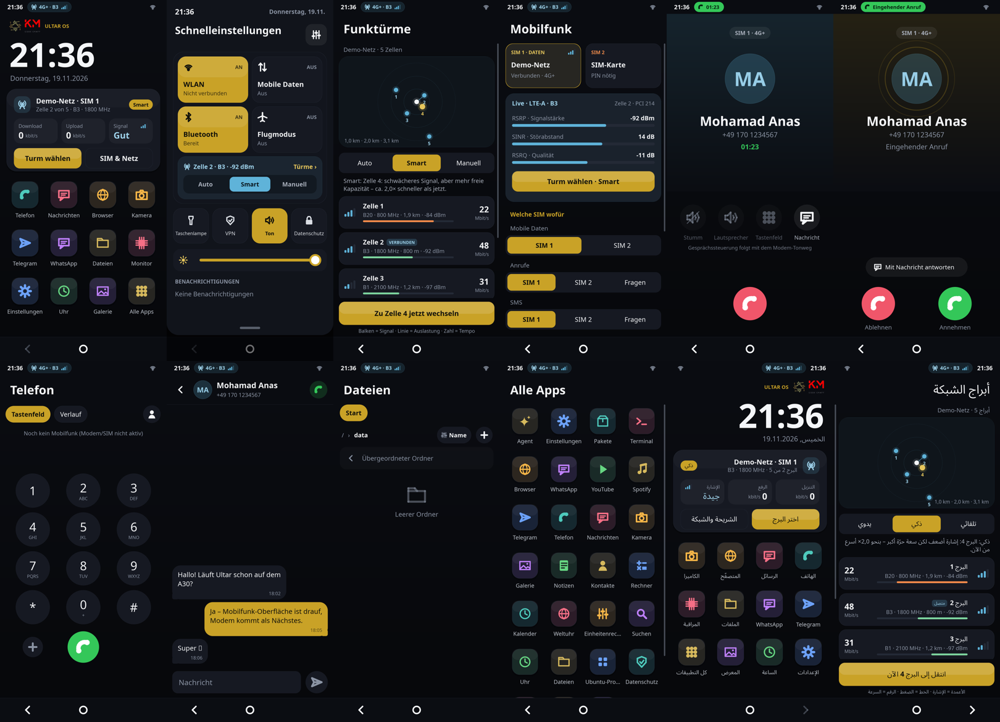

## Start, Schnelleinstellungen, Apps
| Start | Schnelleinstellungen | Alle Apps | Einstellungen |
|---|---|---|---|
| 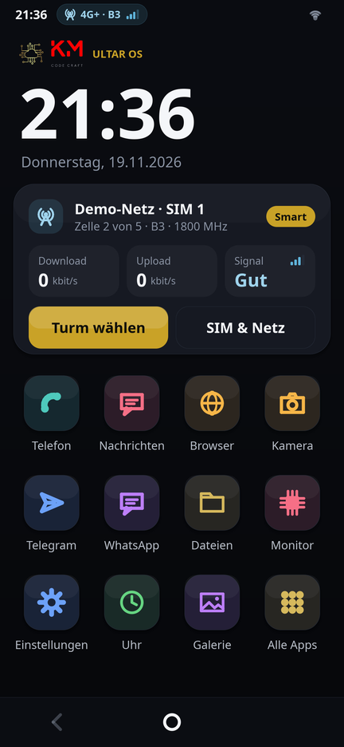 | 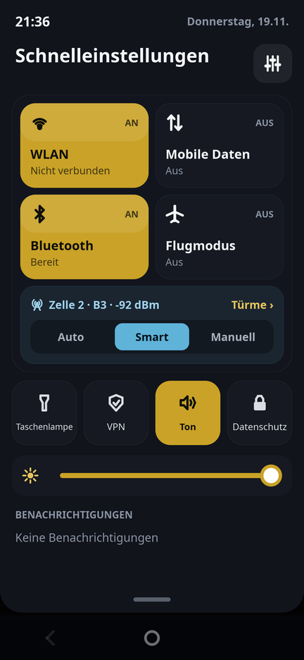 | 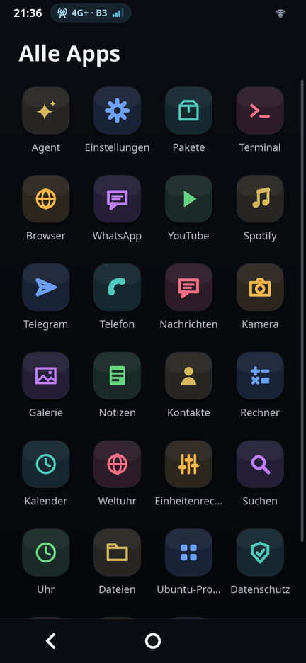 | 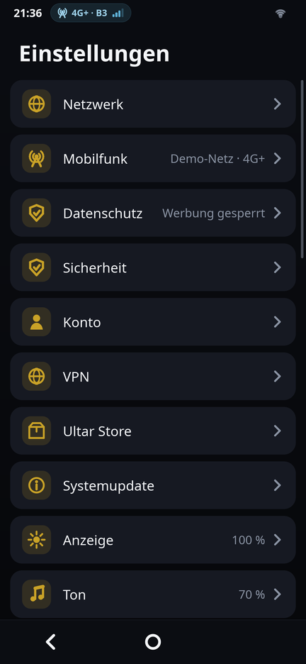 |

## Mobilfunk
| Mobilfunk-Zentrum | Funktürme | Verbindungsweg |
|---|---|---|
| 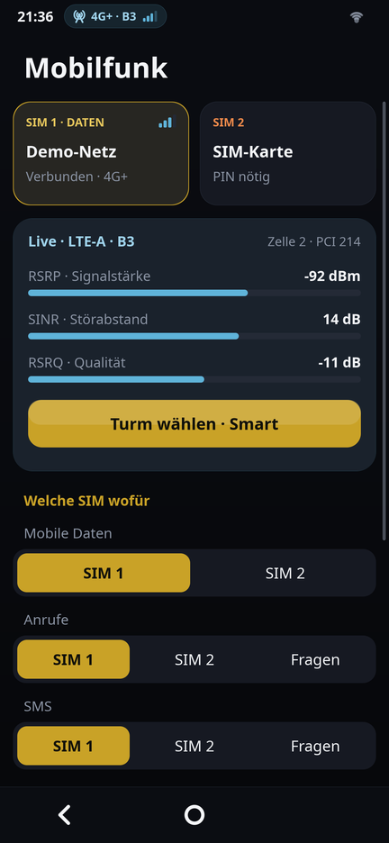 | 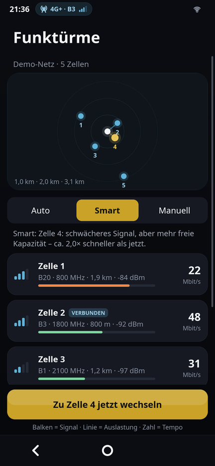 | 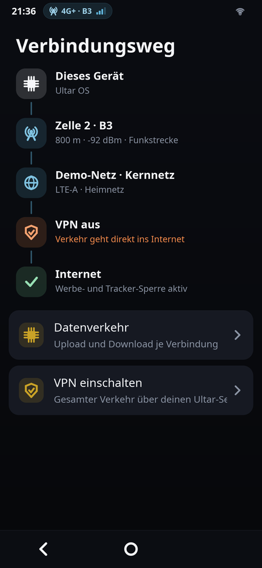 |

## Telefon und Nachrichten
| Telefon | Eingehend | Im Gespräch | Anruf in Schnelleinst. | Nachrichten | Verlauf |
|---|---|---|---|---|---|
| 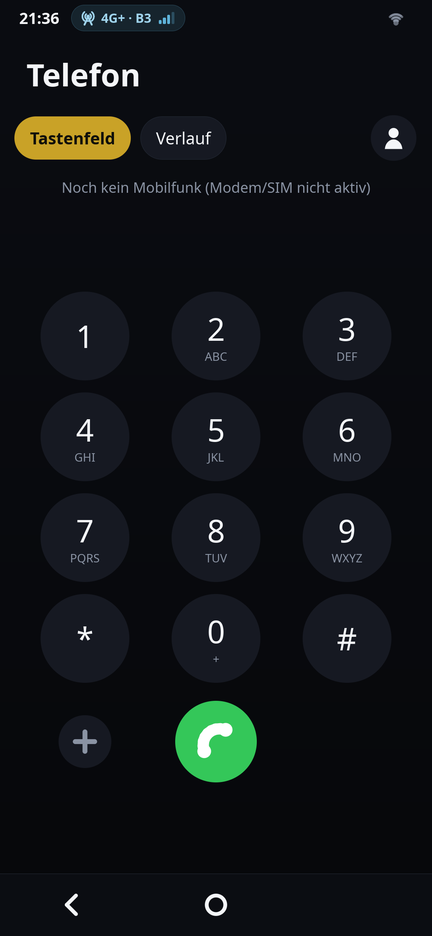 | 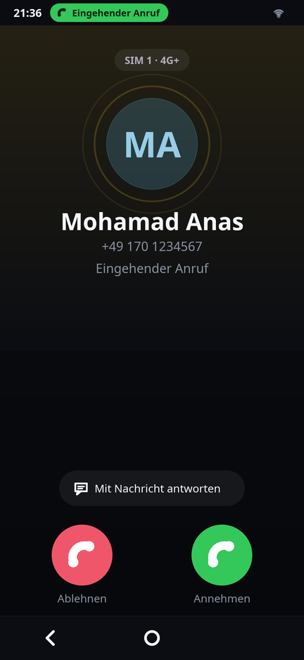 | 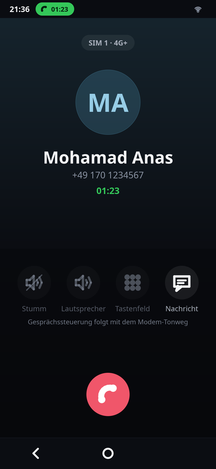 | 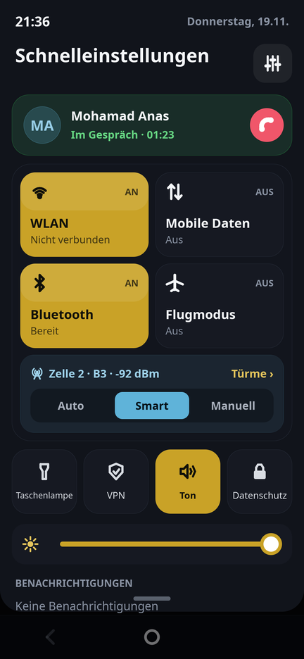 | 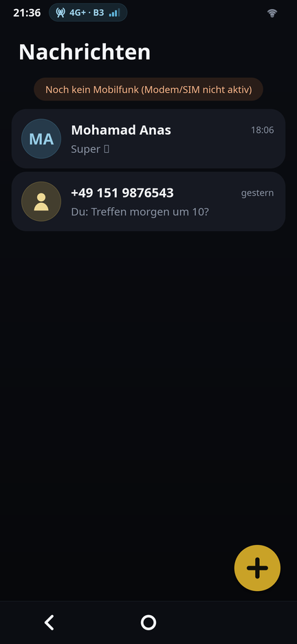 | 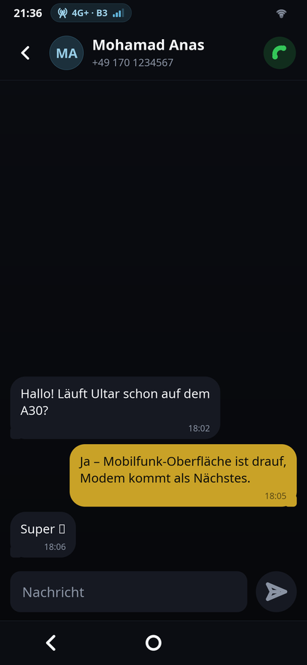 |

## Dateien
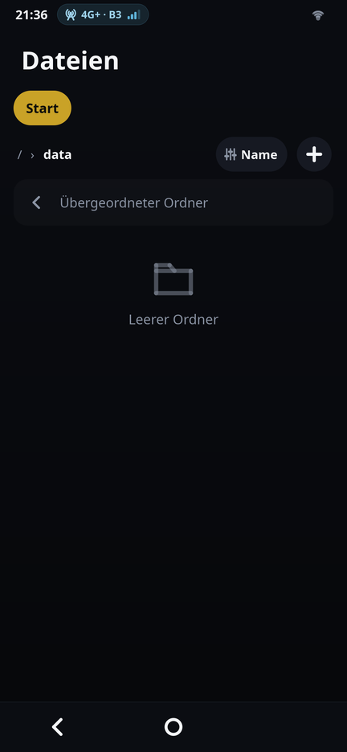

## Arabisch (Rechts nach links)
| Start | Schnelleinstellungen | Funktürme | Anruf |
|---|---|---|---|
| 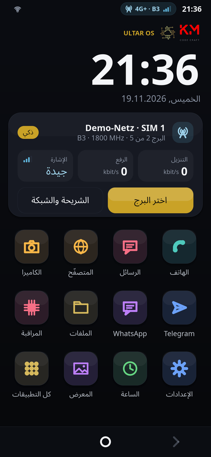 | 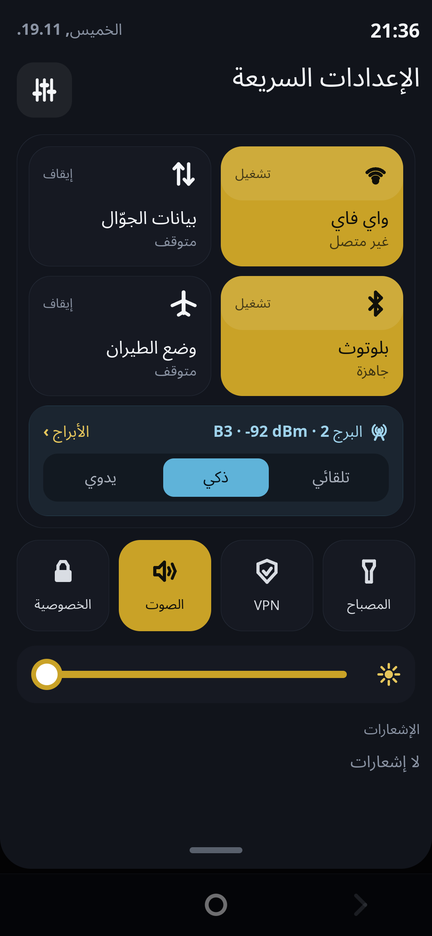 | 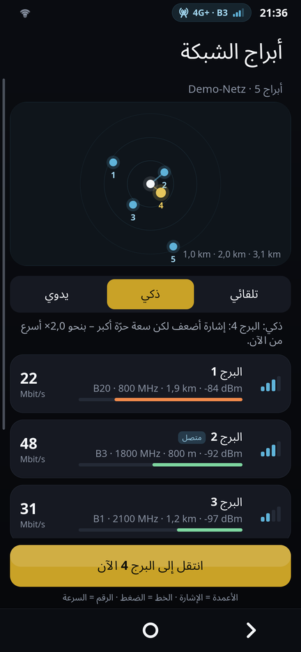 | 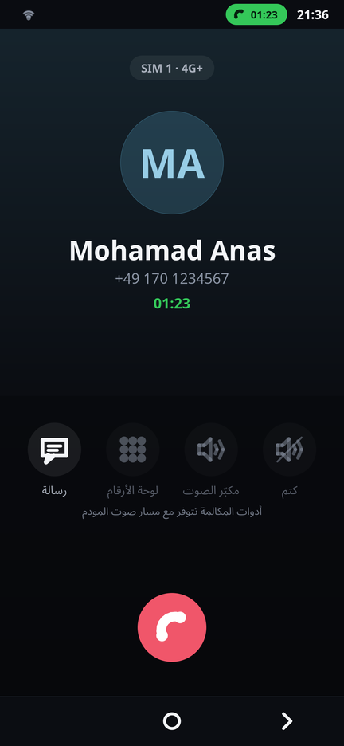 |

## Am Gerät (Galaxy A30, Arabisch)
| Schnelleinstellungen | Funktürme | Dateien |
|---|---|---|
| 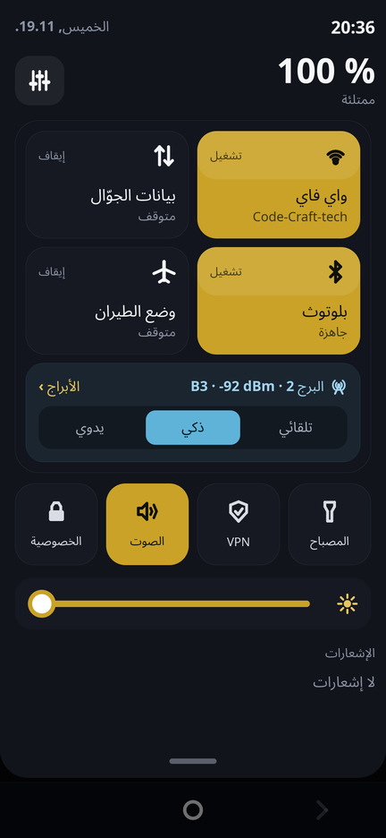 | 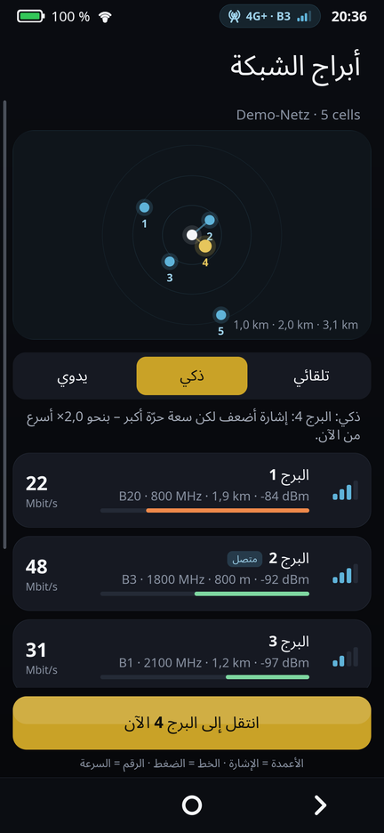 | 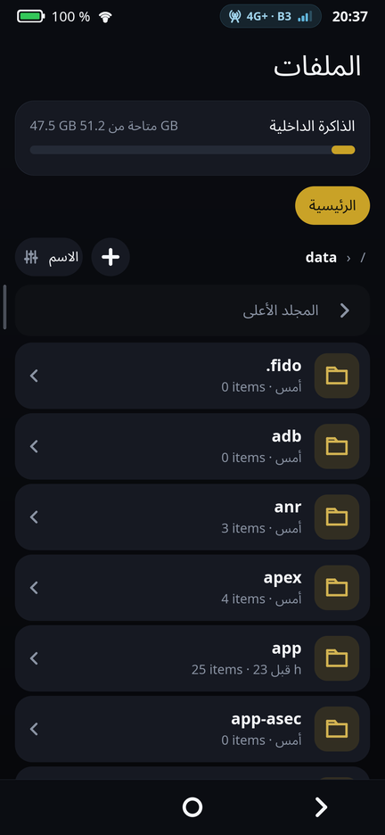 |

Neu aufnehmen: `scripts`-frei – `ULTAR_DATA=/tmp/u ULTAR_RADIO_DEMO=1 ultar-shell --shot 1080 2340 <name> de|ar out.bmp`
mit `<name>` = home, shade, apps, settings, radio, cells, route, phone, call_in, call, call_shade, messages, msgthread, files.
