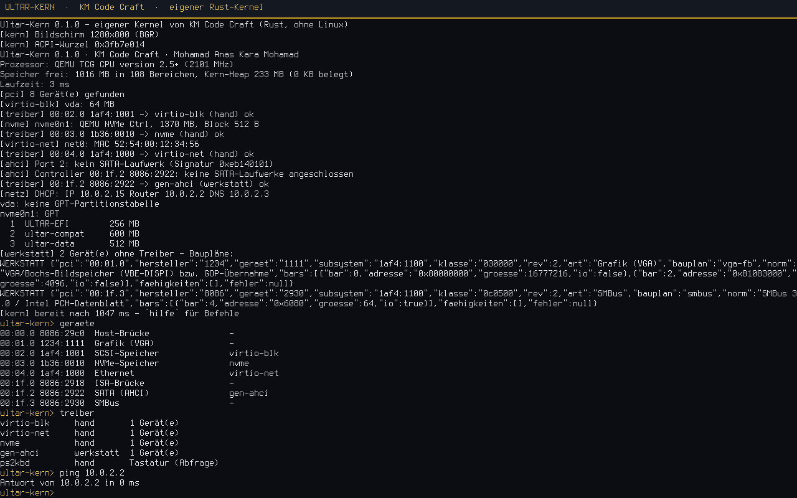

# Ultar-Kern – eigener Kernel (Rust, ohne Linux) – v0.4

KM Code Craft · `kernel/ultar-kern` · Stand v0.3 (Vorschau)

Ziel: Ultar OS unabhängig vom Linux-Kernel machen. Der Ultar-Kern startet direkt per UEFI, übernimmt die Maschine
und betreibt sie mit **eigenen Treibern**. Treiber für neue Geräte entstehen in der **Treiber-Werkstatt**: der Kern
erkennt das Gerät und beschreibt es, ein Sprachmodell schreibt den Treiber nach der offenen Norm, QEMU prüft ihn.



## Was läuft (gemessen in QEMU, OVMF, q35, 4 Kerne)

| Teil | Stand |
|---|---|
| Start | UEFI-Programm (`BOOTX64.EFI`, ~0,5 MB), holt Bildschirm (GOP), Speicherkarte, ACPI, verlässt die Firmware |
| Seitentabellen | **eigene** ab dem ersten Moment: Kern 1:1 mit 2-MB-Seiten, Geräte ohne Zwischenspeicher, NX; je Prozess eigener Adressraum |
| Mehrere Kerne | **SMP mit Planer auf allen Kernen**: weitere Kerne per INIT-SIPI (ACPI-MADT), Daten je Kern über GS/`swapgs`, eigene TSS/IST je Kern, Zeitgeber je Kern; Fäden einer Gruppe laufen zugleich nur auf einem Kern (kein TLB-Abgleich nötig) |
| Unterbrechungen | lokaler APIC (xAPIC/x2APIC), Zeitgeber 100 Hz, Zeitscheibe 20 ms |
| Prozesse | Ring 3, ELF-Lader (statisch, PIE, **dynamisch mit ld.so**), fork/vfork/execve (`#!`), wait4, Rohre, **Fäden** (clone mit CLONE_VM/THREAD/SETTLS/CLEARTID, futex), **Signale** (Handler, Masken, sigreturn, EINTR/SA_RESTART, SIGCHLD/SIGPIPE/SIGSEGV, signalfd) |
| Systemaufrufe | **Linux-kompatibel** (x86_64), ~180 Aufrufe inkl. Sockets, poll/select/**epoll**, **eventfd**, **timerfd**, signalfd, Terminal-ioctl, mount/reboot |
| Netz | Ethernet, ARP, IPv4, ICMP, UDP, **TCP** (Client und Server, Wiederholung, FIN/RST), DHCP, Loopback 127.0.0.1; **Sockets** AF_INET (Strom/Datagramm) und **AF_UNIX** (socketpair, bind/listen/accept/connect) |
| Dateisysteme | **ext4 lesen und schreiben** (metadata_csum: Superblock, Gruppen, Bitmaps, Inodes, Verzeichnisblöcke; anlegen, ersetzen, löschen, mkdir/rmdir; e2fsck ohne Befund); FAT32/16 lesen; RAM-Schicht für /tmp, /run und wo ext4 nicht schreiben kann; `/dev`, `/proc` (ps, free, uptime …) |
| Treiber (hand) | virtio-blk (lesen/schreiben), virtio-net, virtio-rng (Zufall), NVMe (lesen/schreiben), PS/2-Tastatur und -Maus, Brücken |
| Treiber (Werkstatt, 22.11.) | **gen-hda** (HD-Audio: Ausgabe 48 kHz Stereo, Befehl `ton`), **gen-smbus** (Intel-SMBus, Speicherriegel-Kennungen, Befehl `smbus`) – in QEMU geprüft; Verzeichnis aller Treiber: `docs/TREIBER.md`; Ultar OS unter WSL mit X11: `docs/WSL-X11.md` |
| Treiber (Werkstatt) | **gen-ahci** (SATA, lesen/schreiben), **gen-intel-eth** (Intel e1000/e1000e/I219-Familie), **gen-xhci** (USB 3: Boot-Tastaturen und USB-Sticks/-Platten über Bulk-Only/SCSI, **USB-2/USB-3-Hubs** bis 5 Ebenen), **gen-ixgbe** (Intel 10 GbE 82599/X540/X550/**E610** mit Firmwareschnittstelle ACI), **gen-bochs-vga** (erster eigener Anzeigetreiber: Auflösungen umschalten in VMs) – erzeugt, ausgeschrieben, in QEMU geprüft; gen-ixgbe und gen-xhci zusätzlich **am echten server3 über VFIO** geprüft: [SERVER3-TREIBER.md](SERVER3-TREIBER.md) |
| Ubuntu-Programme | **unverändert** aus Ubuntu 24.04: `bash` (interaktiv, Rohre), coreutils (`ls cat sort grep sed cp rm mkdir date df …`), `busybox` (`sh ps free wget nslookup …`) – dynamisch mit glibc, ld.so von der ext4-Partition |
| ultar-init | **läuft als PID 1 auf dem eigenen Kern**: lädt /etc/ultar/services, startet und überwacht Dienste, `ultar-ctl status` über den Steuer-Socket |
| Speicher für Programme | anonymes `mmap` **nach Bedarf** (Seite entsteht beim ersten Zugriff – auch bei Kernzugriffen, futex, fork): glibc-Arenen (64 MB Reservierung) und Fadenstapel kosten nur, was benutzt wird |
| **Sicherheit** | SMEP/SMAP/UMIP/NX, Brandmauer im Kern (von außen standardmäßig nichts erreichbar, still verworfen), zufällige TCP-Folgenummern und Ports, SYN-Cookies, RST-Prüfung, Grenzen gegen Fluten, ARP-Schutz – mit Angriffs- und Datenträger-Fuzzing geprüft: [SICHERHEIT-KERN.md](SICHERHEIT-KERN.md) |
| **Ultar-Verbund** | Schalter `/proc/ultar/verbund` (an/aus) und Konsole `verbund`; bei AUS verwirft der Kern alle Pakete der Verbund-Ports (UDP 47800, TCP 47801); Geräte-Erkennung im Kern; der Dienst `ultar-verbund` (Noise, Kopplung, verteiltes Rechnen) läuft unverändert auf dem Ultar-Kern – siehe docs/VERBUND.md |
| Geräteart | **PC, Laptop, Server, Tablet, Handy** werden erkannt (SMBIOS-Gehäusetyp vor ACPI – Mini-PCs mit Laptop-Chip melden in der FADT „mobil“); die Oberfläche bekommt die passende Ausgabe (`ULTAR_EDITION`), eine feste Einstellung in `/etc/ultar/edition` hat Vorrang. Unter Linux erkennt `ultar-edition` dasselbe über DMI bzw. Gerätebaum + Akku |
| Konsole | `hilfe, info, geraet, anzeige, kerne, geraete, treiber, werkstatt, platten, partitionen, dateien, zeige, start, init, prozesse, spur, netz, dhcp, ipfest, ping, verbund, firewall, sicherheit, tastatur, ton, smbus, zufall, protokoll, neustart, aus` – und jeder Programmname direkt |

Geprüft (QEMU, `tools/kern-test`): Fäden 4 × 100 000 mit Mutex = 400 000, Signale, TCP/UDP über 127.0.0.1,
epoll mit eventfd/timerfd/Rohr (5 Takte à 100 ms in 499 ms),
`busybox wget` über das Netz, Dateien auf ext4 bleiben nach Neustart erhalten, zwei Rechenprozesse auf zwei Kernen
≈ 1,5 × schneller als nacheinander (auf einem Rechner mit nur 2 echten Kernen).

**Startzeit:** Kern bereit nach **~160 ms** (inkl. 4 Kerne, PCI, Treiber, DHCP, Dateisysteme) – in QEMU ohne KVM.
ultar-init meldet „System bereit“ ~1 s nach Kernstart.

Beispiel (serielle Konsole, Ubuntu-Programme auf dem Ultar-Kern):

```
ultar-kern> bash -c 'seq 1 5 | sort -r | tr 1-5 a-e; for i in 1 2 3; do echo Runde $i; done'
e d c b a  (je Zeile)
Runde 1 …
ultar-kern> busybox free
              total        used        free
Mem:         777288      182800      594488
```

Test selbst ausführen:

```bash
IMG=1 scripts/build-kern.sh                      # Kern + FAT-Abbild mit Testprogrammen (user/)
tools/kern-test/make-test-disk.sh                # GPT-Platte: ULTAR-EFI + ext4-Wurzel mit Ubuntu-Programmen
tools/kern-test/qtest.py out/ultar-kern-disk.img "ls -la /" "bash -c 'echo hallo | tr a-z A-Z'"
tools/kern-test/qtest.py out/ultar-kern-disk.img "/boot/efi/bin/kerntest"   # Fäden, Signale, TCP, UDP
tools/kern-test/qtest.py out/ultar-kern-disk.img "/boot/efi/bin/ereignis"   # epoll, eventfd, timerfd
tools/kern-test/qtest.py out/ultar-kern-disk.img "init"                     # ultar-init als PID 1
tools/kern-test/qtest.py out/ultar-kern-disk.img "fadentest 200"            # Speicher bei Fäden/mmap/spawn/fork
sudo tools/kern-test/angriff-test.sh                                         # Portscan, Fluten, kaputte Rahmen
tools/kern-test/medien-fuzz.sh                                              # kaputtes ext4, kaputte Programme
sudo tools/verbund-chaos/kern-test.sh                                       # Ultar-Verbund: Kern + Linux-Gerät im tap-Netz
```

## Selbsttest auf echter Hardware (USB-Stick)

```bash
scripts/make-kern-usb.sh            # Ordner out/ultar-kern-usb → Inhalt auf einen FAT32-Stick kopieren
IMG=1 scripts/make-kern-usb.sh      # zusätzlich out/ultar-kern-usb.img (für Rufus/dd)
```

Der Stick startet den Ultar-Kern (UEFI, Secure Boot aus). Liegt `ultar-kern/selbsttest.txt` auf dem Stick,
läuft der Selbsttest von selbst: Prozessor und Kerne, Speicher, alle PCI-Geräte mit Treiber, Datenträger
(nur lesen), Partitionen, Netz (DHCP, Ping), Programme in Ring 3 (Fäden, Signale, Sockets, epoll, glibc),
Baupläne der Werkstatt für Geräte ohne Treiber. Das Protokoll wird in diese Datei geschrieben (an Ort und
Stelle, die FAT-Verwaltung bleibt unverändert). Auf die Datenträger des Rechners wird nichts geschrieben:
fremde ext4-Partitionen sind nur lesbar, NTFS wird nicht eingehängt. `ultar-kern/auto-aus` schaltet nach dem
Test aus (Server ohne Bildschirm).

Geprüft in QEMU mit einem Nachbau des ThinkPad P15 (NVMe mit Windows-Aufteilung, Intel e1000e, zwei
xHCI-Controller, 8 Kerne, Kern oberhalb 4 GB geladen): 8/8 Kerne, alle Tests OK, Windows-Platte unverändert
(Prüfsumme gleich).

Zielrechner (Stand 22.11.2026): Lenovo ThinkPad P15 Gen 1 (i9-10885H, 64 GB, Samsung NVMe, Intel I219-LM,
Intel/Thunderbolt/NVIDIA-xHCI, Intel AX201 WLAN, Kartenleser GL9755, UHD 630 + Quadro RTX 4000) und
Beelink GTi15 Ultra (Core Ultra 9 285H, server3) als Server – Treiberstand und Prüfung am Gerät: [SERVER3-TREIBER.md](SERVER3-TREIBER.md).
Für moderne Rechner ohne i8042 und mit abgeschaltetem PIT: TSC aus CPUID 0x15/0x16, PS/2 nur wenn vorhanden.

## Treiber-Werkstatt

```
Kern (werkstatt.rs)          tools/treiber-werkstatt/werkstatt.py
───────────────────          ─────────────────────────────────────
Gerät ohne Treiber  ──►  erfassen   Bauplan (JSON: Kennung, Klasse, BARs, Fähigkeiten, Norm)
                          erzeugen   Gerüst src/drivers/gen_<art>.rs + Eintrag + Auftrag (Norm, Schnittstelle, Prüfung)
                          ki         Claude Code (eigenes Abo, `claude -p`) oder lokales Modell (ultar-llm) schreibt aus
                          pruefen    Kern bauen → QEMU mit passendem Gerät → „-> gen-<art> (werkstatt) ok“ + Prüfzeile
```

- Der Kern meldet jedes Gerät ohne Treiber als Zeile `WERKSTATT {…}` und ordnet es einer offenen Norm zu
  (AHCI, NVMe, xHCI, EHCI, HD-Audio, virtio, Intel-/Realtek-Ethernet, VGA/Bochs …).
- Erzeugte Treiber tragen `origin() = "werkstatt"`; `treiber` in der Kern-Konsole zeigt die Herkunft.
- **Regel:** kein Linux-Treibercode (GPL) – Treiber werden aus Norm/Datenblatt neu geschrieben.
- **Nachweis:** AHCI lief genau so: Bauplan aus dem Kernprotokoll → Gerüst (Prüfung schlägt fehl) → ausgeschrieben →
  Prüfung bestanden (`sata0: QEMU HARDDISK`, GPT gelesen).

```bash
scripts/build-kern.sh                       # bauen
RUN=1 scripts/build-kern.sh                 # in QEMU starten
tools/treiber-werkstatt/werkstatt.py erfassen protokoll.txt
tools/treiber-werkstatt/werkstatt.py erzeugen xhci
tools/treiber-werkstatt/werkstatt.py ki xhci --claude          # oder: --lokal http://127.0.0.1:8080/v1/chat/completions
tools/treiber-werkstatt/werkstatt.py pruefen xhci
```

Auf dem PC-/Laptop-Abbild (`scripts/build-pc-image.sh`) erscheint der Kern als Bootmenü-Eintrag
**„Ultar-Kern (eigener Kernel, Vorschau)“**, wenn er vorher gebaut wurde – auf echter Hardware ausprobieren,
`werkstatt` zeigt dann, welche Treiber für genau dieses Gerät fehlen.

## Aufbau

| Datei | Inhalt |
|---|---|
| `src/main.rs` | Startablauf |
| `src/efi.rs` | minimale UEFI-Anbindung (eigene Definitionen, keine Fremdbibliothek) |
| `src/arch.rs` | Ports, GDT/TSS/IDT, Zeit, CPUID |
| `src/paging.rs` | eigene Seitentabellen, Adressräume der Prozesse, fork-Kopie |
| `src/apic.rs` | lokaler APIC, Zeitgeber, ACPI-MADT, Start weiterer Kerne (Trampolin) |
| `src/trap.rs` | gemeinsamer Einstieg für Ausnahmen, Unterbrechungen, `syscall` (inkl. SSE-Zustand) |
| `src/proc.rs` | Prozesse, ELF-Lader, Planer, Warten |
| `src/syscall.rs` | Linux-kompatible Systemaufrufe, Terminal-Zeilendisziplin, AF_UNIX |
| `src/signal.rs` | Signale (Zustellung, Rahmen, sigreturn) |
| `src/socket.rs` | UDP/TCP-Sockets, Loopback, ARP-Warteschlange |
| `src/percpu.rs` | Daten je Prozessorkern (GS) |
| `src/fs.rs`, `ext4.rs`, `procfs.rs` | Einhängepunkte, FAT, ext4 (lesen/schreiben), RAM-Schicht, /dev, /proc |
| `src/mem.rs` | Seitenrahmen, Freiliste, Heap |
| `src/console.rs`, `klog.rs` | Bildschirm/Seriell, PSF-Schrift, Protokoll |
| `src/pci.rs`, `driver.rs`, `drivers/` | PCI, Treiberschnittstelle, Treiber (`gen_*.rs` = Werkstatt) |
| `src/net.rs` | Netzwerkstapel |
| `src/firewall.rs` | Brandmauer: alles zu außer ausdrücklich geöffnet |
| `src/verbund.rs` | Ultar-Verbund im Kern: Schalter, Portsperre, Geräte-Erkennung |
| `src/werkstatt.rs` | Baupläne für Geräte ohne Treiber |
| `src/geraet.rs` | Geräteart (PC/Laptop/Server/Tablet/Handy) aus SMBIOS-Gehäuse, Akku, ACPI-FADT → Ausgabe desktop/server/phone, `/proc/ultar/geraet` |
| `src/grafik.rs` | Anzeige-Schicht: eine Schnittstelle, Treiber je Geräteart (Firmware-GOP, gen-bochs-vga, Intel-Xe als Bauplan; Handy-Anzeige K8), Auflösung umschalten, `/proc/ultar/anzeige` |
| `src/shell.rs` | Kern-Konsole |
| `user/` | Testprogramme für Ring 3 (ohne/mit glibc) |

## Fahrplan (ehrlich)

| Schritt | Inhalt |
|---|---|
| K1 ✅ | Start, Speicher, Ausnahmen, PCI, virtio, NVMe, AHCI (Werkstatt), Netz mit DHCP, Konsole |
| K2 ✅ | eigene Seitentabellen, APIC-Zeitgeber, SMP mit Planer auf allen Kernen – offen: MSI-X (Treiber fragen ab) |
| K3 ✅ | Prozesse und Adressräume, Systemaufrufe, ELF-Lader (statisch, PIE, dynamisch) |
| K4 ✅ | Linux-ABI: Fäden/futex, Signale, Sockets (TCP/UDP/Unix), poll/select/epoll, eventfd, timerfd, signalfd – offen: inotify, Namensräume/cgroups, IPv6, Weitergabe von Deskriptoren (SCM_RIGHTS) |
| K5 | Treiber außerhalb des Kerns mit IOMMU-Schutz – offen |
| K6 ✅ (teilweise) | Intel-Ethernet ✅, Intel 10 GbE E610 ✅ (am Gerät), xHCI mit USB-Tastatur, USB-Sticks und USB-Hubs ✅ (Werkstatt, am Gerät) – HD-Audio-Ausgabe ✅ (QEMU) – offen: Ton-Schnittstelle für Programme (ALSA), SD-Karten (SDHCI), Grafik-Umschaltung, Realtek-Ethernet, USB-Neuerkennung im Betrieb |
| K7 ✅ | ext4 lesen/schreiben (ohne Journal, mit Prüfsummen), ultar-init als PID 1 – offen: Journal, HTree-Verzeichnisse beschreiben, Dateien > 4 Extents |
| K8 | ARM64 (Handys): Gerätebaum statt ACPI/PCI, UFS/eMMC, Display – offen |

**Grenzen:** Grafikbeschleunigung (GPU), WLAN-Chips, Mobilfunkmodems und Handy-Kameras sind ohne offene Unterlagen
nicht aus einer Norm erzeugbar. Dort braucht die Werkstatt Registerbeschreibungen, eigenes Nachmessen am Gerät oder
eine abgeschottete Brücke zu Herstellertreibern. Bis Grafik (GPU/Wayland), WLAN und die
fehlenden Linux-Schnittstellen (epoll, Namensräume …) da sind, bleibt Linux der Kernel der produktiven Ultar-Ausgaben;
der Ultar-Kern läuft als Bootmenü-Eintrag daneben und übernimmt Gerät für Gerät. Auf echter Hardware ist er noch
nicht geprüft – zuerst über das Bootmenü des PC-Abbilds ausprobieren.
