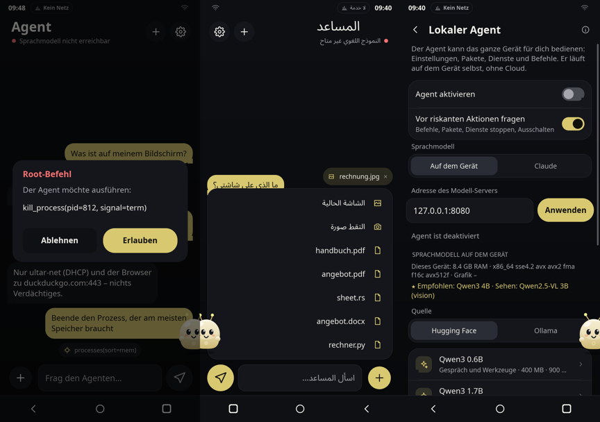

# KM – System-Assistent „wie Jarvis" (Stand 22.11.2026)

KM Code Craft · `crates/ultar-shell/src/app_jarvis.rs` (Oberfläche, Werkzeuge) · `crates/ultar-llm` (Modell-Dienst,
Katalog, Herunterladen, Bilder)

Ein Assistent, der das ganze System kennt und bedient. Er läuft **direkt im Ultar-Kern**: die Oberfläche
`ultar-shell` spricht mit dem Dienst `ultar-llm` (llama.cpp statisch, eigener Bild-Projektor) über 127.0.0.1 bzw.
`/run/ultar/llm.sock`. Kein Ubuntu-Bereich, kein Python, keine Cloud (außer man wählt ausdrücklich Claude).



## Grundsätze

| | |
|---|---|
| **Nur auf Anfrage** | Werkzeuge laufen ausschließlich innerhalb einer Runde, die der Nutzer mit einer Nachricht beginnt (höchstens 8 Schritte). Kein Hintergrund-Handeln, keine eigenen Pläne – steht auch im Systemprompt. |
| **Sieht alles** | Text jeder Seite, die der Nutzer benutzt (Titel, Knöpfe, Werte – Kennwort-/PIN-Felder werden als `[hidden]` ersetzt), Bildschirmfoto der zuletzt benutzten Seite, auf Wunsch die Frontkamera, alles Mitgebrachte. |
| **Root-Zugriff** | Prozesse, Dateien überall, Netzverbindungen je Programm, Protokolle, Datenschutz-Schalter, Befehle als root (direkt im Ultar-System oder im Ubuntu-Bereich). |
| **Bestätigung** | Root-Befehle, Prozesse beenden, Sicherheitsänderungen, Kamera, Dateien schreiben/löschen, Geheimnisse lesen (`/data/ultar`, Schlüssel, Kennwortdateien), Pakete, Ausschalten, Modell-Downloads: **immer** Rückfrage (rot markiert), unabhängig vom Schalter „Vor riskanten Aktionen fragen" (der gilt nur noch für Anrufe/Dienste). Mit Claude als Modell fragt auch das Senden von Bildschirm/Dateien vorher (Daten verlassen das Gerät). |
| **Geschützt** | PID 1 und die Oberfläche selbst lassen sich nicht beenden; `/`, `/data`, `/usr`, `/etc` … nicht löschen. |

## Sehen und Mitbringen

- **„Was ist auf meinem Bildschirm?"** → `see_screen` (Text, ohne Bild-Modell) oder `look_screen` (Bildschirmfoto an das
  Bild-Modell). Festgehalten wird die zuletzt benutzte Seite (nicht das Gespräch selbst), höchstens alle 1,5 s und bei
  jedem Seitenwechsel, in halber Auflösung – kostet praktisch nichts.
- **„Schau mich an"** → `look_at_user`: Frontkamera (auch Samsung-Bildkette über `ultar-cam`), nur wenn die Kamera im
  Datenschutz-Zentrum erlaubt ist, immer mit Rückfrage.
- **Mitbringen:** `+` neben dem Eingabefeld → aktueller Bildschirm, Foto aufnehmen, neueste Bilder/Dokumente. Oder in
  *Dateien* eine Datei halten → **Dem Assistenten geben**. Bilder gehen als Bild an das Modell, Dokumente (PDF, Word,
  Excel, Text) als Text (über `ultar-office`). Nach der Antwort wird das Bild aus dem Verlauf genommen (nicht bei jeder
  Runde neu rechnen).

## Werkzeuge (neu)

`see_screen`, `look_screen`, `look_at_user`, `system_info`, `processes`, `kill_process`, `network_connections`,
`security_status`, `set_privacy`, `logs`, `list_dir`, `read_any`, `write_file`, `delete_path`,
`run_command {"where":"system|ubuntu"}`, `model_status`, `model_download` – dazu alle bisherigen (Apps, Einstellungen,
Büro-Dateien, Hilfe …).

## Modelle: Hugging Face oder Ollama, passend empfohlen

Einstellungen → Lokaler Agent zeigt das Gerät (RAM, Prozessor-Fähigkeiten, Grafik), die Empfehlung (★) und den Katalog;
Quelle wählbar **Hugging Face** oder **Ollama**. Laden direkt in `/data/ultar/models` (reines Rust, fortsetzbar,
SHA-256-geprüft, GGUF-Kennung geprüft). Das Gesprächsmodell wird Standard des Dienstes; Bild-Modelle lädt der Dienst nur,
wenn ein Bild kommt (Anfrage-Modell `vision`).

| Gerät | Gespräch/Werkzeuge | Bilder |
|---|---|---|
| bis ~3,7 GB RAM (Galaxy A30, ARMv8.0 ohne dotprod) | Qwen3 0.6B | SmolVLM2 500M |
| 4 GB | Qwen3 1.7B | SmolVLM2 500M |
| 8 GB Handy | Qwen3 4B | Qwen2.5-VL 3B (nur mit dotprod) |
| 16 GB Handy (OnePlus 15) | Qwen3 8B | Qwen2.5-VL 3B |
| PC 16–32 GB | Qwen3 8B | Qwen2.5-VL 7B |
| PC/Server ≥ 48 GB | Qwen3 30B-A3B (MoE) | Qwen2.5-VL 7B |

Regel: Modell + Kontext ≤ 45 % RAM (Handy) bzw. 55 % (PC); ohne dotprod eine Stufe kleiner. Gemma 3 4B (Bilder, stark
mehrsprachig) steht im Katalog zur Wahl. Dateinamen am 22.11.2026 auf Hugging Face/Ollama nachgesehen.

```
ultar-llm catalog | recommend          Katalog + Empfehlung für dieses Gerät
ultar-llm pull qwen3-1.7b              von Hugging Face (Standard)
ultar-llm pull qwen3-1.7b@ollama       aus der Ollama-Bibliothek
ultar-llm pull hf:ggml-org/gemma-3-4b-it-GGUF/gemma-3-4b-it-Q4_K_M.gguf+mmproj-model-f16.gguf
ultar-llm pull ollama:llama3.2:3b      beliebiges Ollama-Modell
ultar-llm ask "Was siehst du?" --image foto.png
GET /ultar/catalog                     dasselbe als JSON (für Oberfläche/Desktop)
```

Bilder in der Schnittstelle: OpenAI-Teile `{"type":"image_url","image_url":{"url":"data:image/png;base64,…" | "file:///…"}}`
(auch Anthropic-Art `source.data`). Base64-Bilder liegen nur während der Anfrage als private Datei in `/run/ultar/llm-img`.
`/v1/models` meldet je Modell `vision: true`, wenn ein Projektor daneben liegt (`mmproj-<id>.gguf`).

## Geprüft

| Was | Ergebnis |
|---|---|
| `cargo test -p ultar-llm` | 7/7: Empfehlung (A30, OnePlus 15, PC 32/64 GB), Angaben (HF/Ollama/Adresse), Herunterladen gegen nachgebauten HF- und Ollama-Server (Fortsetzen, SHA-256, Projektor) |
| `cargo test -p ultar-shell system_assistent` | Bildschirm wird gemerkt (nicht das Gespräch), `see_screen`/`look_screen`, Bild aus Verlauf nach Antwort, Root-Befehl trotz ausgeschalteter Rückfrage bestätigungspflichtig, Ablehnen, Geheimnisse/Sicherheit/Kamera/kill → Rückfrage, `system_info`/`network_connections`/`model_status` frei, Mitbringen (Foto + Datei), **echte Runde gegen `ultar-llm`** (Test-Engine sieht das Bild) |
| llama.cpp mit Bild-Projektor (mtmd) | baut (x86_64 statisch, 12 MB) |
| **Auf dem Ultar-Kern** (QEMU, eigener Kernel) | `ultar-llm serve` + `ask` über 127.0.0.1, `recommend`, Frage mit Bild → „mock saw 1 image(s)", `/etc/passwd` als Bild abgelehnt |

**Nicht geprüft:** echtes Modell (die Testumgebung erreicht Hugging Face/Ollama nicht) – also Antwortqualität,
Tempo und Bildverständnis mit Qwen/SmolVLM; aarch64-Bau mit mtmd; Kamera am Gerät. Zuerst am PC/Server:
`ultar-llm pull qwen2.5-vl-3b && ultar-llm ask "Was siehst du?" --image bild.png`.
Auffällig im QEMU-Lauf: der Ultar-Kern meldet kein AVX (nur SSE4.2) – llama.cpp rechnet dann ohne AVX deutlich
langsamer; XSAVE/AVX-Freigabe im Kern lohnt sich.
