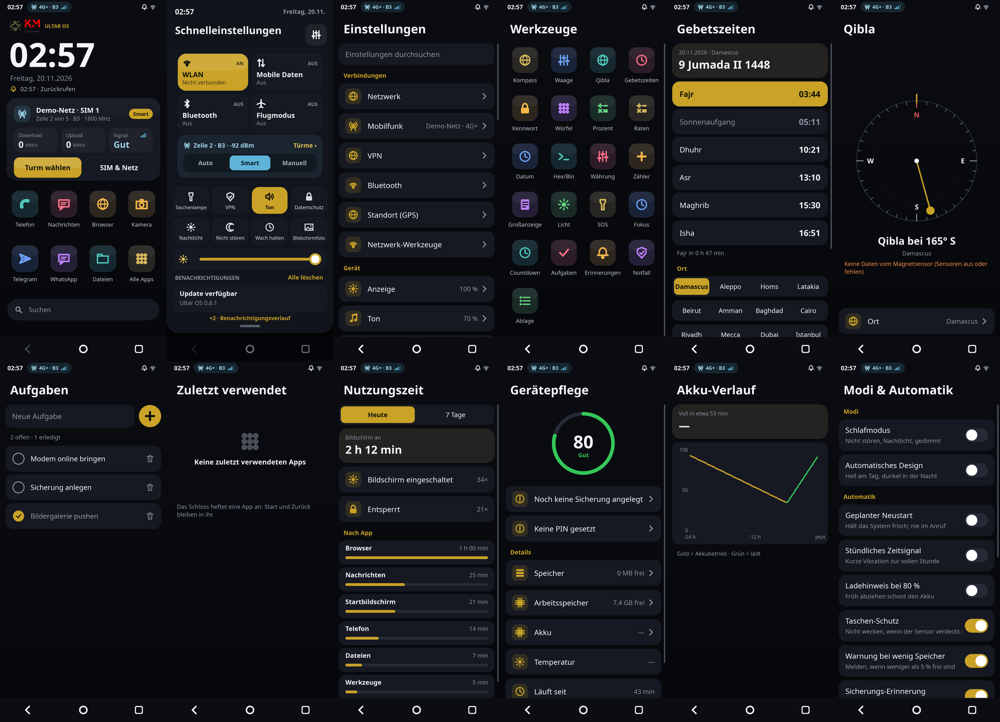

# Ultar OS – Systemfunktionen, zweite Runde (Stand 20.11.2026)

50 weitere Funktionen und der Feinschliff der Oberfläche. Code: `crates/ultar-shell/src/sysy.rs` (Logik, 11 Tests),
`app_more.rs` (Oberfläche, Ablauftest), Einstellungen `/data/ultar/more.toml`, Statistik `/data/ultar/stats.toml`.
Fern-Name = Name für `--shot` bzw. `/run/ultar/shell.goto`.

Stand-Spalte: **Test** = automatischer Test, **Bild** = in 1080×2340, 720×1280 und 1280×800 auf Deutsch, Englisch und
Arabisch gezeichnet und angesehen, **Gerät** = braucht noch die Prüfung am A30 (Sensor, Licht, Modem).

## Werkzeuge (App „Werkzeuge“, Fern-Name `tools`)
| # | Funktion | Fern-Name | Stand |
|---|---|---|---|
| 1 | Kompass (Magnetsensor, Korrekturwert einstellbar) | `compass` | Test (Rechnung), Bild · Gerät |
| 2 | Wasserwaage (Beschleunigungssensor, grün bei unter 1°) | `level` | Test, Bild · Gerät |
| 3 | Qibla-Richtung (Großkreis zur Kaaba, wird grün bei Ausrichtung) | `qibla` | Test (Damaskus, Berlin, New York), Bild · Gerät |
| 4 | Gebetszeiten (16 Städte, 4 Methoden, nächste Zeit hervorgehoben) | `prayer` | Test (Damaskus gegen Sonnenstand), Bild |
| 5 | Hijri-Datum (rechnerisch; Sichtung kann ±1 Tag abweichen) | `prayer`, Start | Test |
| 6 | Kennwort-Generator (Zufallsquelle des Systems, ohne verwechselbare Zeichen) | `password` | Test, Bild |
| 7 | Würfel, Münze, Zufallszahl (gleichverteilt) | `dice` | Test, Bild |
| 8 | Prozent- und Trinkgeldrechner mit Teilen | `percent` | Bild |
| 9 | Ratenrechner (Annuität) | `loan` | Test, Bild |
| 10 | Datumsrechner (Tage dazwischen, Wochentag, Datum plus Tage) | `datecalc` | Test, Bild |
| 11 | Zahlensysteme Dez/Hex/Bin/Okt | `bases` | Test, Bild |
| 12 | Währungsrechner mit eigenen Kursen (ohne Netz) | `currency` | Test, Bild |
| 13 | Zähler mit Ziel 33/99/100/1000 und Vibration | `counter` | Bild · Gerät (Vibration) |
| 14 | Großanzeige (Text so groß wie möglich) | `bigtext` | Bild |
| 15 | Bildschirmlicht (weiß, volle Helligkeit) | Werkzeuge → Licht | Gerät |
| 16 | SOS-Lichtsignal im Morsecode mit dem Kameralicht | `sos` | Test (Takt), Bild · Gerät |
| 17 | Fokus-Timer (Arbeit/5 min Pause, schaltet „Nicht stören“) | `focus` | Bild |
| 18 | Countdown „Tage bis“ | `countdown` | Test (Tage), Bild |
| 19 | Aufgabenliste | `todo` | Bild |
| 20 | Erinnerungen (in 10 min … 24 h, klingeln auch bei Bildschirm aus) | `reminders` | Test, Bild |
| 21 | Notfall (Notruf, Notfallkontakt, medizinische Angaben, SOS) | `emergency` | Bild · Gerät (Anruf braucht Modem) |

## System
| # | Funktion | Wo | Stand |
|---|---|---|---|
| 22 | Zuletzt verwendete Apps (dritte Taste der Leiste) | `recents` | Test, Bild |
| 23 | App anheften (Start/Zurück bleiben in der App; Start halten löst, mit PIN wird gesperrt) | Übersicht → Schloss | Test |
| 24 | Zwischenablage mit Verlauf; „Einfügen“/„Kopieren“ über der Tastatur (nicht bei PIN-/Kennwortfeldern) | `clipboard` | Test, Bild |
| 25 | Statussymbole: Wecker, Nicht stören/Schlafen, lautlos, Fokus, wach halten, angeheftet | Statusleiste | Bild |
| 26 | „Auf einen Blick“ am Start: Fokus, nächste Erinnerung, nächster Wecker, sonst Hijri-Datum | Start | Bild |
| 27 | Suchleiste am Start | Start | Bild |
| 28 | Einstellungen in Gruppen + Filterfeld | Einstellungen | Bild |
| 29 | Besitzerinfo auf dem Sperrbildschirm | `modes` | Bild |
| 30 | Sperrliste für Anrufer (stilles Ablehnen, Vermerk im Verlauf) | `blocked` | Test |
| 31 | Wach halten 30 min (Schnellschalter) | Schnelleinstellungen | Test |
| 32 | Zweite Schalterreihe: Nachtlicht, Nicht stören direkt schalten | Schnelleinstellungen | Bild |
| 33 | Bildschirmfoto-Kachel (3 s Verzögerung) | Schnelleinstellungen | Gerät |
| 34 | Schlafmodus (Nicht stören + Nachtlicht + gedimmt, stellt wieder her) | `modes` | Bild |
| 35 | Automatisches Design (hell am Tag, dunkel nachts) | `modes` | Bild |
| 36 | Geplanter Neustart (täglich oder Wochentag; nie im Anruf, frühestens nach 1 h Laufzeit) | `modes` | Gerät |
| 37 | Akku-Verlauf 24 h | `batthist` | Bild |
| 38 | Restlaufzeit / Zeit bis voll (aus dem Verlauf) | `batthist` | Test, Bild |
| 39 | Nutzungszeit je App, heute und 7 Tage | `usage` | Test, Bild |
| 40 | Zähler: Bildschirm eingeschaltet / entsperrt | `usage` | Bild |
| 41 | Gerätepflege: Zustandswert und Hinweise mit Sprung zur Lösung | `care` | Test, Bild |
| 42 | Speicher-Analyse (größte Ordner/Dateien) | `storagex` | Gerät |
| 43 | Laufende Programme beenden (Systemprogramme geschützt) | `tasks` | Bild |
| 44 | Warnung „Speicher fast voll“ (höchstens täglich) | `modes` | Gerät |
| 45 | Sicherungs-Erinnerung nach 30 Tagen | `modes` | – |
| 46 | Titel antippen = an den Anfang der Liste | alle Listen | – |
| 47 | Taschen-Schutz (Näherungssensor verdeckt → Benachrichtigung weckt nicht) | `modes` | Gerät |
| 48 | Pausen-Erinnerung nach langer Bildschirmzeit | `modes` | – |
| 49 | Stündliches Zeitsignal (Vibration, nicht bei „Nicht stören“) | `modes` | Gerät |
| 50 | Ladehinweis bei 80 % | `modes` | – |

„–“ = eingebaut, aber weder durch Test noch am Gerät bestätigt.

## Feinschliff der Oberfläche
- **Schnelleinstellungen** passen sich der Bildschirmhöhe an: niedrige Bildschirme bekommen einen einzeiligen Kopf und
  flachere Kacheln; passt die Benachrichtigungsliste nicht, steht die Anzahl mit Sprung zum Verlauf über dem Griff.
  Benachrichtigungskarten kompakter, Rest als „+N · Benachrichtigungsverlauf“.
- **Start**: Reihen verteilen den freien Platz, Suchleiste unten, „Auf einen Blick“ unter dem Datum.
- **Leiste unten**: dritte Taste (Übersicht); Start-Taste gold, solange eine App angeheftet ist.
- **Einstellungen**: sechs Gruppen (Verbindungen, Gerät, Persönlich, Sicherheit & Datenschutz, Apps & Dienste, System).
- **Anrufbildschirm**: Bild und Name rücken auf hohen Bildschirmen in die optische Mitte des oberen Teils.
- Werkzeug-Kacheln mit kurzen Namen (keine abgeschnittenen Beschriftungen), Hinweise brechen um statt abzuschneiden.

## Hinweise
- Gebetszeiten gelten für die gewählte Stadt, angezeigt in der Zeitzone des Geräts.
- Kompass ohne Neigungsausgleich: Gerät flach halten; die Achsenzuordnung des A30-Sensors ist am Gerät zu prüfen
  (Korrekturwert im Kompass).
- Nutzungszeit und Statistik bleiben auf dem Gerät.

