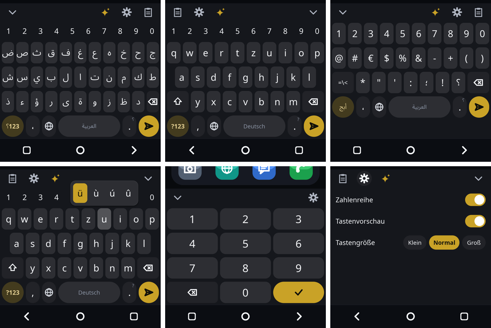

# Ultar-Tastatur (T1: Layout-Kern)

Aufbau wie die Gboard-Vorlage, in Ultar-Farben:

- **Werkzeugleiste:** Zwischenablage (Verlauf, „Kopieren“ des Feldes), Einstellungen der Tastatur, Helfer (übernimmt den
  Feldtext), Ausblenden.
- **Zahlenreihe 1–0:** abschaltbar. Fehlt die Höhe (Querformat), entfällt sie und die Ziffern stehen klein über der oberen
  Reihe (langer Druck).
- **Belegungen:** Arabisch nach Gboard/„Arabisch 101“ (`ضصثقفغعهخحج / شسيبلاتنمكط / ذءؤرىةوزظد`), Englisch QWERTY,
  Deutsch QWERTZ. Untere Reihe: `؟123`/`?123` · `،`/`,` · Sprache · Leertaste mit Sprachname · `.` · runde Aktionstaste in Gold.
- **Ziffern:** überall 0–9, auch im Arabischen; indische Ziffern erzeugt die Tastatur nie, eingefügte werden in Ziffernfeldern
  umgewandelt (`ultar_ime::normalize_digits`).
- **Langer Druck:** Umlaute zuerst (ü, ä, ö, ß), Hamza/Alif-Varianten, `لا`, Taschkil; die Vorauswahl steht über dem Finger.
- **Feldart** aus der Feld-Kennung (`ultar_ime::purpose_for`): PIN (3×4), Telefon und Zahl (4×4), E-Mail (`@`), Adresse (`/`),
  Suche/Senden/neue Zeile als Symbol der Aktionstaste.
- **Bedienung:** Zeichen beim Loslassen (Gleiten auf die Nachbartaste erlaubt), lückenlose Trefferflächen, Löschen sofort
  und wiederholt beim Halten, Umschalter einmal / zweimal schnell = feststellen, Vorschau-Blase.
- **Einstellungen:** `/data/ultar/keyboard.toml` – Zahlenreihe, Tastenvorschau, Größe klein/normal/groß.

## Code
| Datei | Inhalt |
|---|---|
| `crates/ultar-ime` | Belegungen, Varianten, Maße je Bildschirm, Platzierung, Trefferprüfung, Ziffern – ohne Zeichnen (auch für Desktop und Browser) |
| `crates/ultar-shell/src/kbd.rs` | Zeichnen, Bedienung, Zwischenablage- und Einstellungsfeld |

## Prüfung
- `cargo test -p ultar-ime`: Belegungen, keine indischen Ziffern, Maße auf 8 Bildschirmgrößen, keine Überlappung, keine
  toten Zonen, Funktionstasten fest an ihrem Platz, Sprachwechsel.
- `cargo test -p ultar-shell kbd`: Beschriftungen passen mit der echten Schrift; Tippen, langer Druck (ü), Löschen halten,
  Umschalter, Treffer in der Lücke.
- Bildschirmfotos: `ultar-shell --shot <b> <h> kb-<art>[-<sprache>] <sprache> <datei.bmp>`, Arten `text sym sym2 pin phone num
  search note clip set shift pop press` – angesehen in 1080×2340, 720×1280, 2340×1080, 1280×800, 800×1280.
- **Offen am A30:** Tipp-Test mit Probetext und Fehlerquote (braucht das Gerät).

## Nächste Phasen
T2 Zwischenablage-Dienst `ultar-clip` · T3 gemeinsames Textfeld mit Auswahl und Kontextmenü · T4 Vorschläge/Autokorrektur ·
T5 Wischschreiben/Emoji (braucht Emoji-Schrift) · T6 Wayland-Anbindung · T7 Diktieren, Bildschirmtext kopieren.
